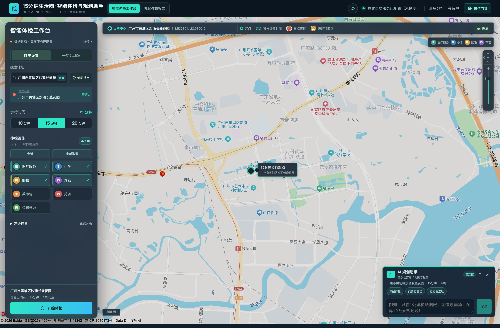

# 15分钟生活圈智能体检与规划助手

面向社区规划、公共服务评估与教学演示的开源空间分析工具，当前支持广州市黄埔区样例。真实地图模式基于百度地图步行路线生成等时圈，统计民生设施覆盖，识别重点服务盲区与设施稀疏区，并提供可解释的体检报告与新增设施改善模拟；无地图或模型凭证时，可使用离线合成样例和规则模式复现流程。

当前赛事候选交付版本为 `2.3.0`，定位为“可信、可解释的生活圈分析”功能型 Beta。版本范围和验证记录见 [V2.3.0 发布说明](life-circle-assistant/docs/releases/v2.3.0.md)，版本变化见 [更新日志](life-circle-assistant/CHANGELOG.md)。`v2.3.0` 标签和正式发布仍待远端门禁通过，离线样例不应被解读为正式规划审批结论。

本文是项目的统一入口，集中维护项目介绍、安装部署、环境变量与开源信息；应用目录 README 仅保留导航，技术细节放在文档目录。当前**未实现登录鉴权、多租户隔离和生产备份**，不要将默认服务直接开放到公网。

[代码仓库](https://github.com/PengJunPJ/life-circle-assistant) · [问题反馈](https://github.com/PengJunPJ/life-circle-assistant/issues) · [贡献指南](CONTRIBUTING.md) · [Apache-2.0 许可证](LICENSE)

## 阅读导航

- 项目概览：[核心功能](#核心功能)、[项目预览](#项目预览)、[技术栈](#技术栈)。
- 安装与使用：[获取代码](#一获取代码并进入正确目录)、[Docker 启动](#二方式-adocker-启动推荐)、[首次使用](#三第一次如何使用)、[真实地图](#四切换真实百度地图可选)、[本地开发](#五方式-b本地开发启动)、[模型解读](#六启用外部模型解读可选)。
- 配置与运维：[环境变量与密钥安全](#七环境变量配置与密钥安全)、[服务器部署与维护](#八服务器部署与维护)、[排障](#九常见问题与检查步骤)、[开发验证](#十开发者验证非普通使用的必需步骤)。
- 深入了解：[文档与参赛材料](#文档与参赛材料)、[已知限制](#已知限制)、[参与贡献](#参与贡献)、[开源治理与合规](#开源治理与合规)、[许可证与致谢](#许可证与致谢)。

## 核心功能

| 能力 | 说明 |
| --- | --- |
| 分析中心点与步行可达性 | 支持地址搜索、地图选点、坐标输入，以及 10、15、20 分钟等时圈；提供快速与正式两档分析精度。 |
| 民生设施体检 | 覆盖菜市场、药店、小学、医疗服务、养老、公园绿地与便利超市七类设施，展示数量、最近步行时间和分类评分。 |
| 服务盲区与证据 | 四类核心设施参与 16 格服务盲区网格测算，展示重点服务盲区、设施稀疏区及判定依据；三类扩展设施计算覆盖度与最近可达。 |
| 规划模拟与比较 | 模拟新增设施，对比原报告与假设场景；支持多方案比较与两份历史报告比较。 |
| 自然语言与 AI 辅助 | 通过对话整理体检需求、解读报告、查询证据和调用规划工具；未启用模型时使用明确标注的规则模式。 |
| 报告留存与导出 | SQLite 持久化任务和历史报告，支持 JSON、CSV、BD-09/WGS84 GeoJSON 与 PDF 导出。 |
| 数据质量与执行披露 | 展示来源、缓存、降级、缺失数据、API 用量及执行账本；未知费用和未核验数据不补造为确定结论。 |

菜市场、药店、小学、医疗服务为核心设施；养老、公园绿地、便利超市为扩展设施。模型负责需求提取、事实选择和工具选择，评分、路线、服务盲区与模拟结果由后端确定性算法计算。对话工作台、AI 核验、报告契约和接口细节见 [应用技术说明](life-circle-assistant/docs/应用技术说明.md)。

## 项目预览



上图为已归档的历史离线演示截图，展示工作台布局；当前默认样例为沙涌长盛花园，界面以实际运行版本为准。真实地图与 AI 实际运行截图见 [2026-10-15 真实采集清单](life-circle-assistant/docs/contest/submission/screenshots-20261015/README.md)，操作流程见 [演示脚本](life-circle-assistant/docs/contest/demo-script.md)。

## 技术栈

| 层次 | 技术 |
| --- | --- |
| 前端 | Vue 3、TypeScript、Vite、Element Plus、ECharts |
| 后端 | Python 3.12、FastAPI、Pydantic、HTTPX |
| 存储与导出 | SQLite、ReportLab |
| 地图与模型 | 百度地图 Web 服务/JavaScript API；可选兼容 Chat Completions 的模型服务 |
| 工程交付 | Docker Compose、Nginx、pytest、Vitest、Ruff、ESLint、GitHub Actions |

第一次使用建议选择下文的 **Docker 离线演示**：无需申请地图密钥，也无需在电脑上安装 Python、Node.js 或数据库。需要修改代码时，再选择本地开发方式。

## 一、获取代码并进入正确目录

安装 Git。Docker 方式还需要安装并启动 Docker Desktop（Windows 使用 WSL 2 后端），或在 Linux 安装 Docker Engine 和 Compose 插件。以下命令使用 `docker compose`，不使用旧版 `docker-compose`。

当前候选版开发在 `feature_pjj_1.0.0` 分支，克隆时明确指定分支：

```bash
git clone --branch feature_pjj_1.0.0 https://github.com/PengJunPJ/life-circle-assistant.git
cd life-circle-assistant
cd life-circle-assistant
```

这里两次 `cd` 是有意的：外层是 Git 仓库，内层才是应用目录。进入正确目录后，应能看到 `docker-compose.yml`、`.env.example`、`backend/` 和 `frontend/`。

如果已经克隆了仓库，在**仓库根目录**执行：

```bash
git switch feature_pjj_1.0.0
git pull --ff-only
cd life-circle-assistant
```

如果默认克隆到了 `main`，不要直接把它当作本文所述候选版；正式版本合并并发布后，可按维护者指定的分支或标签安装。

外部克隆只能获取已推送的提交。部署时记录 `git rev-parse HEAD` 的结果以及所用分支或发布标签，以便复现；本地未提交或未推送的内容不会随他人克隆获得。

目录关系如下，后文未特别说明的部署命令均在内层应用目录运行：

```text
仓库根目录/
├── README.md                  # 项目统一入口与安装部署指南
├── docs/                      # 项目设计与领域文档
├── .github/                   # 质量、安全与发布工作流
├── CONTRIBUTING.md            # 贡献指南
├── LICENSE                    # 仓库许可证
└── life-circle-assistant/      # 应用目录
    ├── README.md              # 简介与导航，不重复维护安装配置
    ├── .env.example           # 可提交的配置模板，不含真实凭证
    ├── .env                   # 自建本地配置，不提交
    ├── docker-compose.yml
    ├── Makefile               # 质量检查与辅助命令
    ├── docs/                  # 应用技术说明、架构、验证与治理
    ├── scripts/               # 冒烟、性能与参赛材料工具
    ├── backend/               # FastAPI 与 SQLite
    └── frontend/              # Vue 工作台
```

## 二、方式 A：Docker 启动（推荐）

评审快速演示可在仓库根目录或应用目录直接执行：

```bash
bash demo.sh
```

该入口使用独立离线配置，自动构建、等待健康、准备七类设施示例报告并验证导出与前端代理；宿主机只需 Bash 与 Docker Compose。`bash demo.sh test` 可再次验证，`bash demo.sh stop` 停止并保留数据。离线镜像打包与导入、端口调整见[评审一键演示指南](life-circle-assistant/docs/contest/quick-start.md)。下文为手动部署步骤。

以下命令均在包含 `docker-compose.yml` 的**应用目录**执行。

### 1. 检查 Docker

```bash
docker --version
docker compose version
docker info
```

`docker info` 应正常返回服务端信息。如果提示无法连接 Docker daemon，先启动 Docker Desktop 或 Docker 服务。

### 2. 创建本地配置

macOS、Linux 或 Git Bash：

```bash
cp .env.example .env
```

Windows PowerShell：

```powershell
Copy-Item .env.example .env
```

已有 `.env` 时先检查内容，不要再次复制覆盖自己的配置。这里使用的是**应用目录的 `.env`**，不是外层仓库的 `.env.local`。

初次演示保留以下配置，其余保持模板默认值：

```dotenv
BAIDU_MAP_MODE=mock
BAIDU_MAP_AK=
BAIDU_MAP_SECRET=
VITE_BAIDU_MAP_AK=
VITE_API_BASE_URL=
AMAP_VALIDATION_ENABLED=false
LLM_ENABLED=false
```

Docker 模式下 `VITE_API_BASE_URL` 保持空值，由前端 Nginx 将 `/api` 转发到后端。第一次构建需要联网下载镜像及依赖；镜像构建完成后，离线快照分析无需请求地图服务。

### 3. 构建并启动

```bash
docker compose up --build --detach --wait
docker compose ps
```

正常情况下 `api` 和 `web` 都会显示为运行且健康。首次构建耗时取决于下载速度，不要在构建尚未完成时判断页面是否可用。

### 4. 打开页面并检查后端

- 使用入口：<http://localhost:5173>
- 后端健康检查：<http://localhost:8000/api/health>
- API 交互文档：<http://localhost:8000/docs>

离线模式的健康检查应包含 `"status": "ok"` 和 `"mode": "mock"`。页面应显示“本地快照”状态；没有百度真实底图是离线模式的正常表现。

### 5. 停止与再次启动

```bash
docker compose down
docker compose up --detach --wait
```

以上两条是停止、再启动的示例，按需要分别执行。修改代码或拉取更新后，重新使用 `docker compose up --build --detach --wait`。

历史报告与步行缓存保存在 Docker 的 `analysis-data` 命名卷中；普通 `down` 不会删除这些数据。不要为日常停止添加 `--volumes` 或 `-v`，它们会删除持久化数据。

## 三、第一次如何使用

1. 打开 <http://localhost:5173>，按页面引导查看当前数据来源。
2. 离线演示保留默认中心：广州市黄埔区沙涌长盛花园，BD-09 坐标为经度 `113.53382359909054`、纬度 `23.08901171541019`。离线快照不支持任意城市或任意地址，只支持样例中心周边约 1 公里；WGS84、GCJ-02 转换需要真实模式。
3. 首次可选择“快速分析”、15 分钟，选择需要体检的设施类别。菜市场、药店、小学、医疗服务参与盲区网格测算；养老、公园绿地、便利超市展示覆盖度和最近可达情况。
4. 点击“开始快照体检”，等待进度完成。系统不会仅因为打开页面就自动开始分析。
5. 查看等时圈、各类设施评分、正常覆盖区、设施稀疏区和重点服务盲区；点击设施可查看路线，结合数据质量说明理解结果。
6. 查看规划建议。在“新增设施改善模拟”中选择设施类别，使用建议候选点或“地图选点”，再点击“运行改善模拟”，查看模拟前后指标。
7. 在报告面板导出 JSON、CSV、GeoJSON（BD-09）、标准 GeoJSON（WGS84）或 PDF；WGS84 出口为本地近似转换，不提供测绘级精度保证。接口与格式说明见 [导出指南](life-circle-assistant/docs/应用技术说明.md#导出指南)。
8. 在历史报告列表打开已有报告，或使用原参数重新运行；选择两份历史报告可进行对比。
9. 使用报告解读功能获取摘要、类别优先级或模拟解读。默认由规则模板生成，不需要模型密钥；启用外部模型的方法见下文。

离线模式使用标记为合成样例的本地快照，部分路线采用明确披露的估算，结果用于演示和复现，不代表当前真实设施状况。“正式分析”是分析精度选项，**不会把 `mock` 自动切换成真实地图模式**。

## 四、切换真实百度地图（可选）

### 1. 准备两类凭证

在百度地图开放平台申请并配置：

- **服务端 Web 服务 AK**：用于地理编码、逆地理编码、地点检索、步行路线/步行矩阵及坐标转换。按项目调用的接口确认权限和配额；若应用采用签名校验，还需要匹配的 Secret。
- **浏览器端 JavaScript API AK**：用于加载百度底图。将实际使用的 `localhost`、`127.0.0.1` 或访问域名加入相应白名单。

两类 AK 用途不同。服务端 AK 和 Secret 仅供后端使用；浏览器 AK 会用于浏览器地图加载，应通过域名限制使用范围。

### 2. 编辑应用目录的 `.env`

以下是配置模板，替换中文占位值；不使用签名校验时 `BAIDU_MAP_SECRET` 留空。

```dotenv
BAIDU_MAP_MODE=real
BAIDU_MAP_AK=替换为服务端AK
BAIDU_MAP_SECRET=
VITE_BAIDU_MAP_AK=替换为浏览器端AK
BAIDU_MAP_QPS=1.5
AMAP_VALIDATION_ENABLED=false
```

QPS 按自己的控制台配额设置。真实模式会消耗接口额度，“快速分析”也会请求百度服务。

### 3. 让配置生效并验证

Docker 用户执行：

```bash
docker compose up --build --detach --wait
```

修改 `.env` 后使用 `up` 让 Compose 重新创建需要更新的容器；只执行 `restart` 不会更新 Compose 注入的环境变量。本地开发用户应停止并重新启动后端。

刷新页面，确认已配置真实模式，点击“验证 Web API”，再确认百度底图已加载。健康检查和状态页只说明配置情况；“验证 Web API”会调用一次地理编码服务，探测成功也不代表地点检索、步行接口和底图权限全部可用。最后在黄埔区选择中心并完成一次真实分析。

真实冷缓存分析可能需要数分钟，耗时取决于设施数量、网络、配额和分析精度。默认会在空缓存时导入随仓库提供的演示中心步行缓存种子，报告会披露缓存命中；这不意味着所有路线都是现场新请求。若需要现场测算，可设置 `LIFE_CIRCLE_SEED_WALKING_CACHE=0` 后使用新的独立数据存储；该开关只阻止启动导入，不会清除已存在的缓存。

当前支持范围仍是广州市黄埔区样例。高德辅助验证不是启动必需项，默认保持关闭。

## 五、方式 B：本地开发启动

不使用 Docker 时，需要自行安装 **Python 3.12** 和 **Node.js 22.22.2 或更新的 22.x**（也可使用符合 `frontend/package.json` 的 Node.js 24.15.0 或更新的 24.x），以及 npm。前端当前依赖不适合使用 Node.js 18、20 或早期 22.x。

先按第二部分创建应用目录的 `.env`，初次使用保留 `mock`。分别打开两个终端启动前后端，不要同时运行占用相同端口的 Docker 版本。

### 1. 终端 A：后端

从**应用目录**开始，macOS/Linux：

```bash
cd backend
python3.12 -m venv .venv
source .venv/bin/activate
python -m pip install -r requirements.txt
python -m uvicorn app.main:app --reload --host 127.0.0.1 --port 8000
```

Windows PowerShell 从**应用目录**开始：

```powershell
cd backend
py -3.12 -m venv .venv
.\.venv\Scripts\python.exe -m pip install -r requirements.txt
.\.venv\Scripts\python.exe -m uvicorn app.main:app --reload --host 127.0.0.1 --port 8000
```

PowerShell 方式直接使用虚拟环境解释器，无需修改脚本执行策略。后端会向上查找应用目录的 `.env`；已导出的同名环境变量优先于文件配置。保持此终端运行，可先打开 <http://localhost:8000/api/health> 确认启动成功。

本地开发的报告和缓存默认保存到 `backend/data/runtime/life-circle.db`，无需额外安装数据库。

### 2. 终端 B：前端

从**应用目录**开始：

```bash
cd frontend
npm ci
```

用编辑器在 `frontend/` 下创建 `.env.local`，写入：

```dotenv
VITE_API_BASE_URL=http://localhost:8000
```

然后运行：

```bash
npm run dev -- --port 5173 --strictPort
```

打开 <http://localhost:5173>。后端和前端终端都必须保持运行，停止时分别按 `Ctrl+C`。

本地 Vite 不会自动读取上一级应用目录的 `.env`，也没有配置 `/api` 代理，因此不要把 Docker 使用的空 `VITE_API_BASE_URL` 原样写入前端 `.env.local`。浏览器地图 AK 由后端 `/api/map/config` 提供，真实模式仍在应用目录 `.env` 配置。

### 3. 需要预览生产构建时

在前端目录执行：

```bash
npm run build
npm run serve
```

访问 <http://localhost:4173>，同时保持后端运行。应用目录 `.env` 中的 `CORS_ALLOW_ORIGINS` 需加入 `http://localhost:4173`（用逗号与已有来源分隔），并重启后端。`VITE_API_BASE_URL` 在构建时固化，修改后必须重新构建。

不要双击 `frontend/index.html` 或 `dist/index.html`，需要通过 HTTP 服务访问。

## 六、启用外部模型解读（可选）

默认 `LLM_ENABLED=false`，规则模板即可使用。已有兼容 Chat Completions 协议的模型服务时，可在应用目录 `.env` 中配置：

```dotenv
LLM_ENABLED=true
LLM_PROVIDER=openai_compatible
LLM_BASE_URL=替换为模型服务的API基础地址
LLM_API_KEY=替换为模型服务密钥
LLM_MODEL=替换为服务支持的模型名称
```

Docker 用户重新执行 `docker compose up --detach --wait`；本地用户重启后端。模型用于左侧“用一句话发起体检”的需求提取、报告事实解读，以及报告内规划助手的工具选择。路线、盲区、评分和模拟仍由后端计算；配置缺失、请求失败或输出校验不合格时，会明确标注规则模式或降级。调用外部模型需要联网，会向该服务发送需求文本、上一轮参数、报告上下文及工具结果，并可能产生费用。

自然语言入口示例：“体检沙涌长盛花园，步行15分钟，关注买菜和买药”。点击“整理需求”，补充缺失信息并确认地址候选，核对可编辑的参数后点击“确认并开始体检”。也可明确使用“当前选点”。不配置模型也可以体验规则解析；离线模式仍只支持内置样例。详见 [自然语言体检入口说明](life-circle-assistant/docs/自然语言体检入口.md)。

完成体检后，在右侧“可解释 AI 规划助手”输入：“查一下菜市场盲区，再模拟新增一个菜市场”。助手会展示实际工具执行记录，模拟成功后同步地图和前后指标。工具问答要求模型服务支持原生 `tools` / `tool_calls` 协议；仅支持文本生成的兼容接口会降级。不启用模型时也可体验明确标注的规则工具流程。详见 [工具规划助手说明](life-circle-assistant/docs/工具规划助手.md)。

规划助手也支持多方案比较：选择盲区、覆盖面积或综合指数目标，模型组织独立候选方案，系统逐项复算并显示可比结果、排名和取舍边界。详见[多方案比较](life-circle-assistant/docs/多方案比较.md)。

## 七、环境变量配置与密钥安全

### 1. 配置文件与生效时机

以 [应用配置模板](life-circle-assistant/.env.example) 为准。只在首次安装时复制为应用目录的 `.env`；更新版本时逐项对照模板补充，**不要覆盖已有配置**。模板默认即可运行离线演示，所有外部凭证均可留空。

| 使用场景 | 配置来源 | 修改后如何生效 |
| --- | --- | --- |
| Docker 后端 | Compose 读取应用 `.env`，并通过 `environment` 显式注入后端；同名 shell 环境变量优先 | 执行 `docker compose up --detach --wait`；仅 `restart` 无效 |
| Docker 前端 | 应用 `.env` 中的 `VITE_API_BASE_URL` 作为构建参数 | 执行 `docker compose up --build --detach --wait`，重新构建前端 |
| 本地后端 | 自动向上查找应用 `.env`；已导出的同名变量优先 | 停止并重新运行 Uvicorn |
| 本地前端 | `frontend/.env.local`，不自动读取应用 `.env` | 开发时重启 Vite；生产静态文件需重新构建 |

`VITE_BAIDU_MAP_AK` 是一个例外：当前实现由后端读取，通过 `/api/map/config` 提供给浏览器，不通过前端 Docker 构建参数传入。外层仓库的 `.env.local` 不是本指南使用的应用配置文件。

### 2. 基础配置与地图服务

下表的默认值以 `.env.example` 和 Compose 为准；“空”表示模板留空，不是填写字符 `空`。所有密钥只在使用对应外部服务时填写。

| 变量 | 默认值 | 用途与填写要求 |
| --- | --- | --- |
| `BAIDU_MAP_MODE` | `mock` | `mock` 为离线快照；真实地图需显式设置 `real` 并提供服务端 AK |
| `BAIDU_MAP_AK` | 空 | 百度 Web 服务 AK，仅供后端使用；核验接口权限、配额和服务端访问限制 |
| `BAIDU_MAP_SECRET` | 空 | 百度签名校验 Secret；仅在应用启用相应签名校验时填写，禁止发送给前端 |
| `BAIDU_MAP_QPS` | `1.5` | 百度提供方请求速率上限，按账号实际配额调整 |
| `VITE_BAIDU_MAP_AK` | 空 | 浏览器地图 AK，会在浏览器可见；使用独立凭证并设置域名白名单 |
| `VITE_API_BASE_URL` | 空 | 不包含 `/api` 后缀。Docker 留空走同源 Nginx；本地前端填 `http://localhost:8000` |
| `CORS_ALLOW_ORIGINS` | `http://localhost:5173,http://127.0.0.1:5173` | 逗号分隔的完整来源（协议、主机、端口）；不允许空列表或 `*`，CORS 不代替鉴权 |
| `API_HOST_PORT` / `WEB_HOST_PORT` | `8000` / `5173` | Compose 宿主机端口，可自行添加到应用 `.env`；默认均仅绑定 `127.0.0.1` |
| `AMAP_VALIDATION_ENABLED` | `false` | 高德辅助设施验证开关，不替代百度主分析，也不是启动必需项 |
| `AMAP_WEB_SERVICE_KEY` / `AMAP_QPS` | 空 / `1` | 高德服务端 Key 与请求速率；启用验证时需核验权限及数据使用授权 |
| `BAIDU_NATIVE_ISOCHRONE_ENABLED` | `false` | 可选百度原生步行等时圈；开启前另行确认账号权限与费用 |

### 3. 数据存储与步行计算

| 变量 | 默认值 | 用途与注意事项 |
| --- | --- | --- |
| `LIFE_CIRCLE_DATABASE_PATH` | 空 | 本地默认为 `backend/data/runtime/life-circle.db`；建议自定义时使用绝对路径。Compose 固定为容器内 `/app/data/runtime/life-circle.db`，仅改 `.env` 不会改变该路径 |
| `LIFE_CIRCLE_SEED_WALKING_CACHE` | `1` | 空缓存启动时导入历史演示步行缓存；`0` 禁止导入，但不清除已有缓存 |
| `WALKING_CACHE_TTL_SECONDS` | `86400` | 步行缓存有效期，单位秒 |
| `WALKING_MAX_CONCURRENCY` / `WALKING_QPS` | `6` / `8` | 步行计算并发与调度限速；还会受百度提供方 QPS、接口权限和账号配额约束 |
| `WALKING_TIMEOUT_SECONDS` | `8` | 步行请求超时，单位秒 |
| `WALKING_MAX_RETRIES` / `WALKING_RETRY_BASE_SECONDS` | `2` / `0.25` | 最大重试次数与重试退避基数（秒） |
| `LIFE_CIRCLE_PDF_FONT_PATH` | 未设置 | 可选本地中文 TrueType 字体路径，适用于非 Docker 环境；不在默认模板或 Compose 注入项中，Docker 自带中文字体 |

### 4. 可选模型、语义嵌入与 OCR

| 变量 | 默认值 | 用途与填写要求 |
| --- | --- | --- |
| `LLM_ENABLED` / `LLM_PROVIDER` | `false` / `openai_compatible` | 关闭时使用规则解析、规则解读与规则工具流程 |
| `LLM_BASE_URL` | `https://api.openai.com/v1` | 兼容 Chat Completions 服务的 API 基础地址，例如服务方提供的 `/v1` 地址，不填写完整 `/chat/completions` 路径 |
| `LLM_API_KEY` / `LLM_MODEL` | 空 / 空 | 启用模型时填写服务端密钥和模型标识；工具规划还要求服务支持 `tools` / `tool_calls` |
| `LLM_TIMEOUT_SECONDS` / `LLM_MAX_TOKENS` | `30` / `1200` | 请求超时（秒）和单次输出 token 上限 |
| `LLM_MAX_CONCURRENCY` / `LLM_MAX_RETRIES` / `LLM_RETRY_BASE_SECONDS` | `2` / `2` / `0.5` | 模型并发、重试次数与退避基数（秒） |
| `SEMANTIC_EMBEDDING_ENABLED` / `SEMANTIC_EMBEDDING_PROVIDER` | `false` / `openai_compatible` | 可选中文语义召回；结果为待人工审核候选，不直接成为正式评分事实 |
| `SEMANTIC_EMBEDDING_BASE_URL` / `SEMANTIC_EMBEDDING_MODEL` / `SEMANTIC_EMBEDDING_API_KEY` | 均为空 | 启用兼容嵌入服务时配置地址、模型与服务端密钥 |
| `SEMANTIC_EMBEDDING_MODEL_PATH` | 空 | `SEMANTIC_EMBEDDING_PROVIDER=local` 时指定本地模型，需额外安装 `sentence-transformers` 并预置模型；默认镜像不保证具备该运行环境 |
| `OBSERVATION_OCR_ENABLED` | `false` | 可选居民图片 OCR；关闭或失败仍可人工复核 |
| `OBSERVATION_OCR_ENDPOINT` / `OBSERVATION_OCR_API_KEY` | 空 / 空 | OCR 服务端点和密钥；接口契约见 [治理与评估说明](life-circle-assistant/docs/governance/ai-first-governance-and-evaluation.md) |

启用远程模型、嵌入或 OCR 前，应确认服务商的数据处理条款、用户授权和费用；不要向外部服务发送无权共享的文本、图片或报告信息。

### 5. 可选规范与费用估算

以下配置默认全部为空，不影响离线启动。金额以人民币计；未配置价格代表费用未知，**不代表免费**。估算账本不代替服务商账单。

| 变量 | 配置说明 |
| --- | --- |
| `LIFE_CIRCLE_NORMS_PATH` | 外部规范 JSON 路径，需包含来源、版本、适用范围和人工核验信息；留空仅引用项目 ADR。Docker 必须使用容器内路径，并通过自建 Compose 覆盖文件只读挂载规范文件 |
| `MAP_PRICING_UNIT` | 仅选 `request` 或 `route_pair`，避免普通地图请求与路线坐标对重复计价 |
| `MAP_REQUEST_PRICE_CNY` / `ROUTE_PAIR_PRICE_CNY` | 每次地图请求 / 每个路线坐标对的单价，对应上述计价单位 |
| `EMBEDDING_PRICING_UNIT` | 仅选 `request` 或 `tokens` |
| `EMBEDDING_REQUEST_PRICE_CNY` / `EMBEDDING_PRICE_CNY_PER_MILLION` | 每次嵌入请求 / 每百万 token 单价 |
| `NATIVE_ISOCHRONE_PRICE_CNY` / `OCR_REQUEST_PRICE_CNY` | 每次原生等时圈 / OCR 请求的单价；原生等时圈不会再按普通地图请求双算 |
| `LLM_INPUT_PRICE_CNY_PER_MILLION` / `LLM_OUTPUT_PRICE_CNY_PER_MILLION` | 模型每百万输入 / 输出 token 的单价 |

地图和嵌入计价单位留空时，只有填写一个对应价格才能自动推断单位；同时填写两个价格或全部留空时不会推断。规范文件、OCR 和嵌入服务的详细约定见 [治理与评估说明](life-circle-assistant/docs/governance/ai-first-governance-and-evaluation.md)。

### 6. API Key 脱敏与保管

- README、截图、演示视频、Issue、提交记录和日志中只使用空值或 `已脱敏`、`替换为服务端AK` 等占位内容；它们不是可用凭证，不要原样用于真实模式。
- 服务端 AK、Secret、模型密钥、嵌入密钥和 OCR 密钥只保存在本机 `.env` 或部署平台受控配置中，禁止写入前端源码或任何会打包进浏览器的 `VITE_*` 变量。浏览器地图 AK 是有意公开的例外，必须与服务端凭证分开并限制域名。
- `.env`、`.env.local` 已由忽略规则排除，但忽略规则不能保护已被 Git 跟踪的文件。提交前检查 `git status --short`；不要使用强制添加方式提交凭证，也不要公开完整的 `docker compose config`、容器环境变量或带鉴权参数的请求 URL。
- 在 macOS/Linux 可执行 `chmod 600 .env` 限制其他本机用户读取；Windows 请设置等效文件访问权限。不要把 `.env` 放进前端静态资源目录或公开下载目录。
- 对外分享配置示例前，将敏感值整体替换为 `已脱敏`；日志还应去除鉴权头、URL 中的 `ak`、`key`、`sn` 等鉴权参数和个人信息。不要仅依赖截取密钥的前后几位。
- 若发生泄露，立即在服务商控制台撤销并轮换凭证，更新配置并重建相应容器；仅删除文件、遮盖截图或新增忽略规则不能使已经泄露的密钥失效。安全反馈见 [安全策略](SECURITY.md)。

## 八、服务器部署与维护

### 1. 单机部署边界

当前 Compose 适合单机、受控演示，不是开箱即用的公共 SaaS 部署方案。默认宿主机映射为 `127.0.0.1:5173` 和 `127.0.0.1:8000`；远程电脑不能通过服务器公网 IP 直接访问，这是安全限制，不是启动失败。

在服务器安装 Git、Docker Engine 和 Compose 插件，按前文进入应用目录、创建 `.env` 后执行：

```bash
docker compose up --build --detach --wait
docker compose ps
curl --fail --silent --show-error http://127.0.0.1:8000/api/health
curl --fail --silent --show-error http://127.0.0.1:5173/api/health
```

第二个健康地址经过前端 Nginx 的 `/api` 代理，可一并验证前后端连通。两项均应返回 `status=ok` 和预期模式；健康检查**不会探测真实地图 API**，不证明配额、权限或模型服务可用。需具备支持 `up --wait` 的 Compose 版本，旧版本请先升级插件。

仅供自己远程演示时，可在自己的电脑执行 SSH 隧道（替换示例用户名和主机名）：

```bash
ssh -N -L 15173:127.0.0.1:5173 user@your-server
```

然后访问 <http://localhost:15173>，保持 SSH 连接。前端 API 地址继续留空，同源代理无需开放后端端口；真实底图需为实际浏览器访问的主机配置白名单。

### 2. 通过域名提供受控访问

需要多人访问时，由部署方在现有网关或反向代理上完成以下配置，再开放入口：

1. 配置域名、HTTPS 证书，以及认证、访问控制和请求限流。认证必须覆盖整个应用和 `/api`，不能只保护首页；不要把真实密钥配置为 URL 查询参数。
2. 将站点根路径及 `/api/` 一并代理到本机 `http://127.0.0.1:5173`，由内置 Nginx 转发后端；使用独立域名根路径，不假设支持任意子路径部署。
3. `VITE_API_BASE_URL` 保持空值，避免浏览器请求用户自己的 `localhost:8000`，也避免 HTTPS 页面调用 HTTP API 的混合内容问题。
4. 按实际来源设置 `CORS_ALLOW_ORIGINS`，例如 `https://life-circle.example.com`，不含路径；更新浏览器地图 AK 的域名白名单。CORS 白名单不是访问权限控制。
5. 防火墙只允许必要的 HTTPS、管理入口；不要将 `8000` 或 `5173` 改绑公网作为访问控制的替代。Swagger `/docs` 当前仅由后端端口提供，前端站点不会自动代理它。

本仓库未提供域名证书、网关认证、自动重启策略或监控告警配置，需由部署方另行落实。默认使用单个 API 实例；未验证共享 SQLite 的多副本扩容，不要直接增加副本数或 Uvicorn worker 数。

### 3. 数据持久化、备份与更新

本地报告与缓存默认存放在 `backend/data/runtime/`；Compose 将 `analysis-data` 命名卷挂载到 `/app/data/runtime`。普通 `docker compose down` 和镜像重建不会清除该卷；`down -v`、删除卷或清理卷会造成数据丢失。固定应用目录和 Compose 项目名，否则可能连接到新的空卷，误以为历史报告消失。

更新前先记录代码版本，并等待分析任务完成。以下为 macOS/Linux/Git Bash 的**手工停机备份示例**，会短暂停止 API；它复制整个运行目录，以保留 SQLite 及可能存在的 WAL 文件，不应在写入过程中只复制单个 `.db`：

```bash
git rev-parse HEAD
backup_dir="backups/$(date +%Y%m%d-%H%M%S)"
mkdir -p "$backup_dir"
docker compose stop api
docker compose cp api:/app/data/runtime/. "$backup_dir/"
docker compose start api
docker compose ps
```

备份目录可能包含敏感报告，**不要提交到 Git 或放到公开站点**；将其转存到受控的独立存储，检查复制是否成功，并再次验证健康接口。若复制失败，也应恢复 API 服务后排查。`.env` 不在数据卷内，需通过受控渠道单独备份。

确认备份后，在工作区无待处理冲突且部署目标仍是当前分支时更新：

```bash
git pull --ff-only
docker compose up --build --detach --wait
docker compose ps
```

启动时会执行数据库迁移。保留更新前版本和备份；发生问题时先停止写入，在独立环境验证旧代码与备份的兼容性再切换，不要假设数据库可自动降级，也不要直接覆盖仍在运行的数据库。当前没有自动备份与一键恢复功能，正式使用前必须自行演练恢复流程。

### 4. 部署验收清单

- `docker compose ps` 中 `api`、`web` 均健康，后端直连及前端代理的 `/api/health` 均成功，运行模式与配置一致。
- 页面完成一次样例快速分析，能查看等时圈、设施覆盖、服务盲区和规划建议，并成功导出一份报告。
- 正常重建容器后历史报告仍可读取；已保存备份并确认恢复方案，不使用删卷命令清理日常环境。
- 真实模式分别验证 Web 服务与浏览器底图，核对报告中的真实调用、缓存及数据质量披露；外部模型失败时仍可看到明确的规则降级提示。
- 对外入口已启用 HTTPS 和认证，API 端口未公开，凭证与日志已脱敏；服务器重启后的启动与告警责任已明确。

## 九、常见问题与检查步骤

| 现象 | 检查与处理 |
| --- | --- |
| 提示找不到 Compose 配置 | 当前目录必须包含 `docker-compose.yml`；确认进入了仓库内的应用子目录。 |
| Docker 无法连接服务端 | 启动 Docker Desktop/Engine，用 `docker info` 确认。 |
| 首次构建下载超时 | 检查能否访问镜像源、Python 包源和 npm 源；网络恢复后重试构建。首次安装不能完全离线。 |
| `8000` 或 `5173` 被占用 | 停止占用端口的旧进程；或在应用 `.env` 添加 `API_HOST_PORT=18000`、`WEB_HOST_PORT=15173` 后重新执行 Compose `up`，改访问 `http://localhost:15173` 和 `http://localhost:18000/api/health`。Docker 的内部代理无需修改。 |
| 页面空白 | 通过 HTTP 地址打开，不要双击 HTML；确认 `web` 已健康，并查看浏览器控制台。 |
| 页面能打开，接口请求失败 | Docker 检查 `api` 是否健康、前端 API 地址是否为空；本地开发检查后端 `8000` 是否运行、前端 `.env.local` 是否指向它。 |
| 本地访问出现 CORS 错误 | 页面地址的协议、主机、端口必须与后端 `CORS_ALLOW_ORIGINS` 中的一项完全一致；修改后重启后端。默认只允许 `localhost:5173` 和 `127.0.0.1:5173`。 |
| `npm ci` 提示 Node 版本不兼容 | 核对 `node --version`，使用上文指定版本，不用 `npm install` 替代锁文件安装。 |
| 仍显示本地快照 | 核对应用目录 `.env` 的 `BAIDU_MAP_MODE=real` 和服务端 AK；重新创建 Docker 容器或重启本地后端，并检查同名 shell 环境变量是否覆盖文件值。 |
| 真实底图没有加载 | 检查浏览器 AK 的应用类型、域名白名单和网络；底图加载与 Web 服务连通性需要分别验证。 |
| 搜索地址或确认坐标失败 | 离线使用默认中心或范围内 BD-09 坐标；任意地址和外部坐标转换需真实模式。黄埔区范围外暂不支持。 |
| 真实分析缓慢或返回部分结果 | 查看任务阶段、数据质量和服务日志，核对接口额度、权限、限流和超时；先降低分析精度，不要反复并发提交。 |
| 本地 PDF 中文显示异常 | Docker 镜像已包含中文字体；本地可安装文泉驿字体，或用 `LIFE_CIRCLE_PDF_FONT_PATH` 指向可被 ReportLab 加载的中文 TrueType 字体后重启后端。 |

Docker 用户可在应用目录查看状态和日志：

```bash
docker compose ps
docker compose logs --tail 100 api web
```

本地开发用户查看前后端终端输出。对外分享配置和日志前去除密钥；不要提交 `.env`、`.env.local` 或自己的运行数据库。

## 十、开发者验证（非普通使用的必需步骤）

如果需要修改代码，可在应用目录、已激活后端虚拟环境的终端安装开发依赖并运行检查：

```bash
python -m pip install -r backend/requirements-dev.txt
make quality
```

`make quality` 会运行后端与前端检查、构建及隔离端口的 Docker 冒烟测试，需要 `make`、Python、npm、Docker 和 Bash；后端测试还需要 `pdftotext` 及中文字体（Ubuntu/Debian 可安装 `poppler-utils` 和 `fonts-wqy-zenhei`）。Windows 建议在 WSL 中运行统一检查。它固定使用离线模式，无需地图密钥。

检查包括后端 Ruff 静态与格式检查、自动化测试，以及前端 ESLint、类型检查、单元测试、生产构建和容器冒烟；也可分别执行 `make backend-check`、`make frontend-check` 或 `make container-check`。

仓库通过 [质量工作流](.github/workflows/quality.yml) 在推送和 Pull Request 中执行质量检查，以 `质量门禁汇总` 作为分支保护应绑定的统一检查项；[安全工作流](.github/workflows/security.yml) 执行 CodeQL、依赖漏洞和密钥扫描；[发布工作流](.github/workflows/release.yml) 在 `vX.Y.Z` 标签通过质量门禁后构建并推送带 SBOM/provenance 的 GHCR 镜像、创建 GitHub Release。生产发布仍需配置部署平台、GitHub Environment、审批人和密钥，不能将工作流文件的存在视为已完成发布。

## 文档与参赛材料

| 阅读目的 | 文档入口 |
| --- | --- |
| 查看对话工作台、报告契约、缓存与导出接口 | [应用技术说明](life-circle-assistant/docs/应用技术说明.md) |
| 理解地图 API、等时圈、设施清洗与服务盲区算法 | [技术设计文档](docs/技术设计文档.md)、[算法概览](life-circle-assistant/docs/contest/algorithm-overview.md) |
| 理解模块与接口边界 | [系统架构](life-circle-assistant/docs/architecture/v2-trustworthy-analysis.md)、[后端结构](life-circle-assistant/backend/ARCHITECTURE.md)、运行后的 [API 文档](http://localhost:8000/docs) |
| 了解自然语言与规划助手 | [自然语言入口](life-circle-assistant/docs/自然语言体检入口.md)、[工具规划助手](life-circle-assistant/docs/工具规划助手.md)、[多方案比较](life-circle-assistant/docs/多方案比较.md) |
| 核验 AI 与空间能力的实现范围 | [AI 融合验收记录](life-circle-assistant/docs/validation/ai-first-completion-2026-10-14.md)、[空间验证](life-circle-assistant/docs/validation/spatial-completion-2026-10-14.md)、[治理与评估](life-circle-assistant/docs/governance/ai-first-governance-and-evaluation.md) |
| 查看真实社区验证与性能 | [真实社区对比报告](docs/真实社区对比测试报告.md)、[网格基准指南](life-circle-assistant/docs/validation/v2.1-benchmark-evaluation.md)、[性能基线](life-circle-assistant/docs/performance/v2-baseline.md) |
| 查看版本与维护计划 | [更新日志](life-circle-assistant/CHANGELOG.md)、[候选发布说明](life-circle-assistant/docs/releases/v2.3.0.md)、[维护路线](life-circle-assistant/docs/governance/maintenance-roadmap.md) |
| 核验参赛交付物 | [参赛材料入口](life-circle-assistant/docs/contest/README.md)、[作品介绍 PDF](life-circle-assistant/docs/contest/submission/15-minute-life-circle-competition-brief.pdf)、[证据索引](life-circle-assistant/docs/contest/evidence-index.md) |
| 生成截图、作品介绍和执行材料预检 | [材料生成步骤](life-circle-assistant/docs/应用技术说明.md#参赛材料生成) |
| 查找术语与架构决策 | [领域上下文](CONTEXT.md)、[架构决策记录](docs/adr/) |

技术文档目录同时包括仓库级 `docs/` 和应用级 `life-circle-assistant/docs/`；本表为统一索引，安装部署与变量默认值以本 README 为准。

## 已知限制

- 当前真实模式限定广州市黄埔区样例，离线模式限定沙涌长盛花园样例范围；不支持任意城市分析。
- 离线合成快照、历史步行缓存与最新真实调用在报告中分别披露，不能互相替代；真实 API 失败或缺失会影响报告完整度与评分范围。
- 百度是当前主分析来源。高德仅用于默认关闭的辅助验证，书面数据留存/公开展示许可与独立双源准确率验证尚未完成。
- 既有 64/64 网格核查属于单社区、百度同源一致性证据，不代表跨来源准确率、现场步行精度或多社区泛化能力。
- 模型预测和未核验居民观察不进入正式评分；AI、嵌入、OCR 和原生等时圈的真实效果及部署账号权限需另行验证。
- 标准 WGS84 GeoJSON 使用本地近似转换，不提供测绘级精度保证；设施改善模拟不等同于土地、人口、容量与建设成本的完整可行性论证。
- 当前没有账号权限、多租户隔离、生产监控或自动备份能力，定位为功能型 Beta。用于实际决策前需人工核验数据与结论。

详细范围、验证状态与尚未完成项见 [限制与披露](life-circle-assistant/docs/contest/limitations.md) 和 [证据索引](life-circle-assistant/docs/contest/evidence-index.md)。

## 参与贡献

欢迎提交问题复现、文档改进、测试、交互优化与分析算法改进。开始前请阅读 [贡献指南](CONTRIBUTING.md) 和 [行为准则](CODE_OF_CONDUCT.md)。

1. 在 [GitHub Issues](https://github.com/PengJunPJ/life-circle-assistant/issues) 描述问题或建议，附上版本、运行模式、复现步骤、预期结果与脱敏日志；较大的变更先与维护者讨论。
2. Fork 仓库或从目标分支创建工作分支，保持改动聚焦；涉及报告契约、数据来源或授权边界时同步更新文档。
3. 代码变更运行 `make quality`，记录命令与结果；依赖或基础镜像变更按贡献指南补充审计。文档变更核对链接与示例。
4. 提交信息统一使用 `feat: 中文提交说明`，标题与正文使用中文；提交 Pull Request 时说明目的、影响范围、验证结果及数据/隐私影响。

安全问题请按 [安全策略](SECURITY.md) 通过私密渠道报告，避免在公开 Issue 中披露漏洞细节、密钥、个人信息或原始地图响应。维护职责见 [维护者说明](MAINTAINERS.md)。项目目前未启用 DCO 或 CLA，贡献者仍需确认拥有代码与附带材料的提交权利。

## 开源治理与合规

- [贡献指南](CONTRIBUTING.md)、[行为准则](CODE_OF_CONDUCT.md)、[安全策略](SECURITY.md)、[维护者说明](MAINTAINERS.md)
- [开源治理](life-circle-assistant/docs/governance/open-source-governance.md)、[维护路线](life-circle-assistant/docs/governance/maintenance-roadmap.md)
- [依赖合规清单](life-circle-assistant/docs/governance/dependency-compliance.md)、[第三方声明](life-circle-assistant/docs/governance/third-party-notices.md)、[SBOM 说明](life-circle-assistant/docs/governance/sbom/README.md)

依赖漏洞扫描和许可证材料是工程审计证据，不是法律意见；高德辅助验证的授权与独立准确率证据仍待补充。

## 许可证与致谢

项目代码采用 **Apache License 2.0**，详见仓库 [LICENSE](LICENSE) 与应用 [LICENSE](life-circle-assistant/LICENSE)。使用、修改与分发时请遵守许可证及第三方声明，保留适用的版权和许可信息。

代码许可证不授予百度、高德或模型服务数据的再分发权；地图调用、缓存、展示与导出仍受相应服务条款和授权范围约束。依赖及外部服务说明见 [第三方声明](life-circle-assistant/docs/governance/third-party-notices.md) 与 [依赖合规清单](life-circle-assistant/docs/governance/dependency-compliance.md)。

感谢 Vue、FastAPI、ECharts、Element Plus、SQLite、ReportLab 等开源项目及其贡献者，也感谢百度地图开放平台提供地图能力。
