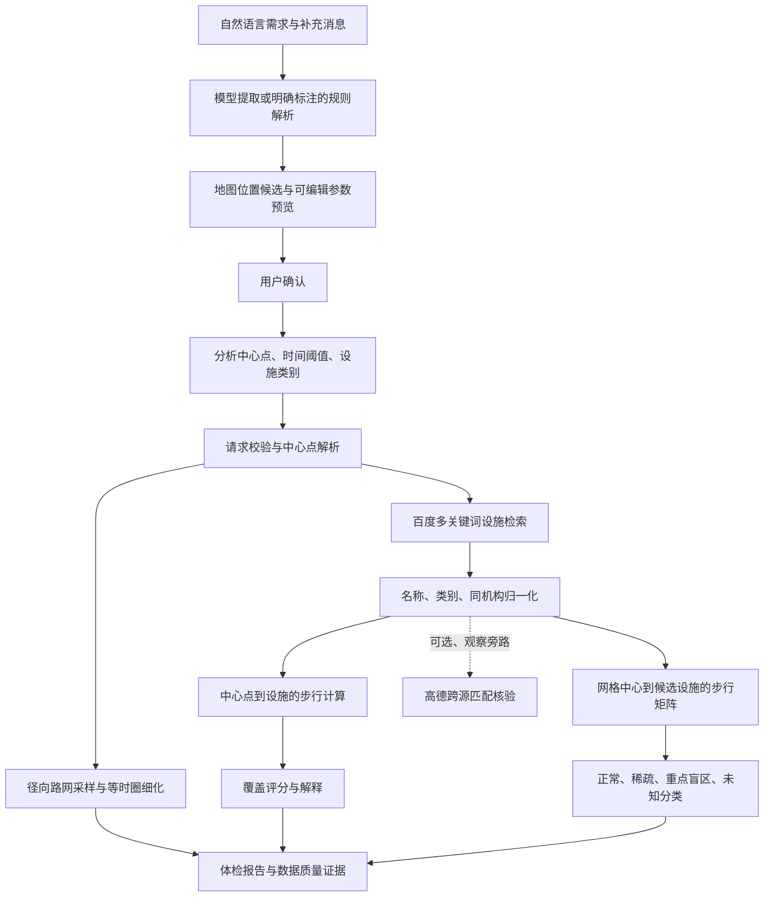

# 15分钟生活圈智能体检与规划助手：技术设计文档

编写日期：2026-10-12。实现基线：当前仓库；真实测算证据基线：2.3.0，详见[真实社区对比测试报告](真实社区对比测试报告.md)。本文面向参赛技术评审，区分现有实现、验证旁路与尚未实现的改进设计。

## 1. 目标、范围与实现状态

系统从用户选定的分析中心点出发，检索民生设施，使用地图提供方的步行路网时间生成近似等时圈，并逐网格识别正常覆盖区、设施稀疏区和重点服务盲区，输出可解释体检报告。

| 要求 | 当前实现 | 验证边界 |
| --- | --- | --- |
| 地图 API 调用策略 | 百度检索、路线/矩阵、限流、重试、持久化缓存 | 有真实冷/热缓存证据；调用计数不是计费账单 |
| 路网等时圈 | 步行时间驱动的径向采样与边界细化 | 依赖百度路网；未自行部署路网图搜索引擎 |
| 多源民生设施清洗 | 百度单源归一化已在主流程；跨源匹配模块、高德验证旁路已实现 | 默认不融合主分析；独立双源人工精度验证未完成 |
| 服务盲区 | 核心四类设施、4×4 网格、双条件分类、失败显式标记 | 基于网格中心，不代表每户居民或每处入口 |
| 真实社区对比 | 沙涌长盛花园、红山街道的归档真实 API 数据 | 支持路网与直线估算对比；现场步行感受待采集 |
| 自然语言发起体检 | 模型/规则提取、多轮补充、地图位置候选、可编辑参数、确认启动 | 模型不提供坐标或测算结论；外部模型真实连通性尚未验证 |

当前七类设施为菜市场、药店、小学、医疗服务、养老、公园绿地、便利超市。核心四类生成网格服务区域；扩展三类仅进入设施覆盖和评分，不生成独立盲区结论。

历史领域文件存在差异：根目录 `CONTEXT.md`、[评分 ADR-0011](adr/0011-可解释规则评分与数据质量提示.md)仍写四类等权；当前代码采用七类配置权重，本文按代码与报告披露。此差异应在后续领域文档同步中处理。分类还覆盖“有近邻但步行超时”的稀疏区；[ADR-0006](adr/0006-mvp设施类别与盲区判定标准.md)早期定义只描述另一种稀疏情况。其“球面距离”表述与当前函数实际采用的局部平面距离近似也有差异。

## 2. 总体架构与数据流

前端负责输入、地图图层、任务进度和报告展示；后端负责分析编排、空间计算、规则评分及数据质量记录；SQLite 保存任务、报告与步行坐标对缓存。统一空间坐标为 BD-09，等时圈与网格以 GeoJSON 返回。



关键输入为中心经纬度、中心选择方法、时间阈值（支持 10/15/20 分钟）、类别集合、演示/分析模式。关键输出包含 `parameters`、`calculation_mode`、`execution`、`data_quality`、`facilities`、`facility_normalization`、`isochrone`、`service_areas`、`scoring` 和 `recommendations`。

主流程代码：[analysis/service.py](../life-circle-assistant/backend/app/analysis/service.py)。空间范围须分开理解：设施发现为总中心 3 km 半径，网格为中心周围 2 km×2 km，等时圈采样半径上限为 1,250 m；这些范围不等同。

## 3. 地图 API 调用策略

### 3.1 接口与坐标契约

| 用途 | 百度 Web 服务路径 | 策略 |
| --- | --- | --- |
| 地址转中心点 | `/geocoding/v3/` | 用户地址解析 |
| 中心点地址解释 | `/reverse_geocoding/v3/` | 报告展示地址 |
| 民生设施检索 | `/place/v2/search` | 按类别多关键词，3 km 半径，`scope=2`、每页 20 条 |
| 坐标转换 | `/geoconv/v2/` | WGS84/GCJ-02 转 BD-09；已有 BD-09 保持不变 |
| 单条步行路线 | `/directionlite/v1/walking` | 距离、时间及路线步骤；供单点计算和路线展示 |
| 多坐标对步行 | `/routematrix/v2/walking` | 批量距离/时间，不含路线折线 |

当前每个检索关键词只取第一页，不能把检索数量称为社区完整设施总数。关键词结果先按提供方 UID 去重，再按归一化名称与六位小数坐标去重。任一关键词检索失败时披露类别不完整，不能把失败解释成“该类别没有设施”。

内部坐标与 GeoJSON 都按 BD-09 使用。[ADR-0010](adr/0010-统一坐标与空间交换格式.md)规定此契约。外部 GIS 通常默认 GeoJSON 为 WGS84，导出后进入外部工具前必须显式转换，不能直接叠加。高德旁路使用 GCJ-02，查询中心与返回设施须分别转换。

### 3.2 批量、并发与限流

百度提供方将矩阵拆成最多 100 个坐标对的块；每块起点最多 10 个，终点数按 `floor(100 / 起点数)` 决定。相同候选设施集合的网格合并请求，避免逐格逐设施调用。矩阵失败可回退逐对路线，并发上限为 6；单坐标对优先路线接口以保留步骤。

两层控制承担不同职责：步行包装器默认并发 6、QPS 8；底层百度客户端对全部请求共享限流锁，`BAIDU_MAP_QPS` 默认 1.5。实际吞吐仍受更低的提供方限流与账户配额制约，扩大并发不等于扩大可用 QPS。

百度客户端超时为 8 秒，最多 3 次尝试，对超时、HTTP 错误和可重试状态使用 `0.4×2^attempt` 秒退避。步行包装器还有最多 2 次重试、0.25 秒基础退避，两层重试可能累积延时，调参时应同时考虑。不可重试的返回错误不无限重试。

### 3.3 缓存、来源与可观测性

步行缓存键包含提供方、有方向的起终点、出行方式，经纬度精度 6 位小数；默认 TTL 为 86,400 秒。只缓存成功结果，保留实际数据来源与时间戳。反向路线不能自动复用正向路线，跨提供方不能串用。

默认离线种子可在空缓存中导入归档步行数据，因此真正冷测须使用新数据库并设置 `LIFE_CIRCLE_SEED_WALKING_CACHE=0`。该开关不会清除已有缓存。热缓存报告应显示缓存来源，不能称为重新向提供方实时测算。

报告记录阶段耗时、缓存命中/未命中、重试、超时、最终失败和降级。`execution.api_calls` 等于设施调用计数与步行调用计数之和；它不含逆地理编码、坐标转换、辅助提供方、浏览器路线预览等请求，底层 HTTP 重试也未逐次计入。因此只能作为应用统计口径，不能用来承诺实际计费次数。

服务端 AK 由环境配置；浏览器使用独立浏览器 AK，按账户实际访问限制设置。当前客户端读取 `BAIDU_MAP_SECRET`，但没有生成 `sn` 的签名逻辑，不能据此宣称已支持 SN 签名认证。

实现入口：[baidu.py](../life-circle-assistant/backend/app/baidu.py)、[maps/baidu.py](../life-circle-assistant/backend/app/maps/baidu.py)、[maps/walking.py](../life-circle-assistant/backend/app/maps/walking.py)、[walking_cache.py](../life-circle-assistant/backend/app/storage/walking_cache.py)。

## 4. 等时圈：基于路网时间的近似可达范围

### 4.1 路网意义与算法选择

可达集合定义为 `R(T) = {p | shortest_walk_time(center, p) ≤ T}`。道路、连接关系和步行规则由地图提供方维护，本项目查询提供方的路线时间，未获取完整路网图，也未自行实现 Dijkstra 或 A*。输出是对可达集合边界的有限采样近似，区别于按固定步速画圆。

### 4.2 已实现的径向采样与细化

分析模式取 24 个等角方向，演示模式取 16 个方向；角间隔分别为 15°、22.5°。对角度 θ 与半径 r，以局部近似生成候选点：

```text
lng = center_lng + cos(θ) × r / (111320 × cos(center_lat))
lat = center_lat + sin(θ) × r / 111320
```

纬度余弦计算使用弧度。首轮半径固定为 1,250 m，所有方向一起请求步行矩阵。对每个方向执行：

```text
若首轮路线失败：记录失败，舍弃该方向
若首轮时间 ≤ T：边界取 1250 m 处，不继续向外扩张
否则：low = 0，high = 1250
      分析模式细化 3 次；演示模式细化 2 次
      midpoint = (low + high) / 2
      路线成功且时间 ≤ T：low = midpoint
      路线成功且时间 > T：high = midpoint
      路线失败：记录质量事件，中止该方向细化
      边界取 low 处
按角度连接边界并闭合为多边形
有效方向少于 6：使用明确标为降级的演示边界
```

边界不足或细化失败会记入数据质量记录；`low=0` 也可能留下中心点，所以“24 个方向有边界”不表示 24 个非零有效通路。面积使用经纬度多边形鞋带公式，再按局部比例换算平方米。

### 4.3 精度与限制

在“同一射线上时间随半径单调增加”的假设下，3 次二分后的半径搜索区间为 156.25 m，2 次为 312.5 m；这不是实际空间误差保证。不同小区入口、桥梁和不连通道路可能破坏单调性。

固定 1,250 m 上限可能截断实际可达范围，尤其对 20 分钟阈值；多边形连接可能跨越不可通行区域，不能表达孔洞或多个不相连的可达片区。路网接口时间仍是模型估计，未逐项纳入现场过街等待、入口开放时间、无障碍条件、天气和个体步速。

`isochrone.properties.max_duration_s` 收集了部分中间探测的超阈值时间。真实案例中该值为 2,069 秒，不能把它解释为“15 分钟最终边界的最大到达时间”。`successful_sample_count` 表示生成边界的方向数量，不是多边形内部可达性的全覆盖认证。

### 4.4 后续路网图算法设计（尚未实现）

若采用授权可用的独立步行路网，可构建有向图 `G=(V,E)`：节点为路口和入口，边为可步行路段，边权为长度/步速与明确的通行等待成本；不可步行边删除，受限出入口保留时段约束。先将真实起点吸附到可通行路段，再从起点执行带时间截断的 Dijkstra；只扩展累计成本不超过 T 的节点，跨越阈值的边在边内插值求终止点。随后以可达路段缓冲和空间并集合形成展示面，并保留孔洞与分离片区。

优先可做的改进是动态外扩采样上限、增加路障附近采样、边界路线再次核验，避免直接把近似外壳当作完整真实可达区域。图搜索、动态外扩与孔洞处理均为后续设计，当前报告数据未使用。

## 5. 多源民生设施数据清洗与实体对齐

### 5.1 百度主流程：已启用的单源语义归一化

数据最少保留 ID、名称、类别、经纬度、地址、来源；报告增加标准名、语义子类、别名、合并 ID、规则版本、置信度与原始记录数量，以便审计。

清洗步骤包括 NFKC 字符标准化、空白与标点处理、类别子类型识别。相同类别中，重复 ID 或名称相同且距离不超过 80 m 的记录可归并；医疗机构还提取母机构名称，识别发热门诊、科室等附属条目。在同机构键，或满足规定名称根前后缀关系且距离不超过 80 m 的情况下归并。代表记录优先母机构而非下属科室，同时保留别名和来源链。

仅名称相似不足以认定同一设施；同品牌不同门店、不同校区不能随意合并。清洗能减少重复计数，但不能独立证明设施真实存在、营业中、对公众开放或业务类别正确。最新案例 153 条归并为 151 条，其中医疗 35→33；养老、公园、便利设施的细分语义仍较弱。

代码：[facility_normalization.py](../life-circle-assistant/backend/app/analysis/facility_normalization.py)。

### 5.2 跨源匹配：模块已实现，默认不接入主融合

高德辅助核验默认由 `AMAP_VALIDATION_ENABLED=false` 关闭；开启后仍为观察旁路，`affects_primary_analysis=false`。百度主结果不被辅助匹配自动替换。跨源模块先统一坐标与类别，再计算：

```text
match_score = 0.35 × 名称相似度
            + 0.30 × 地址相似度
            + 0.25 × max(0, 1 - 距离米 / 100)
            + 0.10 × 类别一致项
```

| 条件 | 当前决策 |
| --- | --- |
| 类别或坐标系不一致 | 冲突，不自动合并 |
| 距离 >100 m | 不匹配 |
| 50 m < 距离 ≤100 m，得分 ≥0.65 | 人工复核 |
| 距离 ≤50 m，得分 ≥0.85 或地址相似度 ≥0.8 | 匹配 |
| 距离 ≤50 m，得分 ≥0.65 但不满足上一行 | 人工复核 |
| 同时匹配多个实体簇 | 歧义，不自动选择 |

跨源代表记录按 `retrieved_at`、来源优先级、地址完整性选取；坐标分散超过 25 m 或地址明显不一致会记录冲突。`source_updated_at` 超过 30 天标记陈旧，缺失则新鲜度未知；检索时间不能替代设施实际更新时间。

实现：[facility_reconciliation.py](../life-circle-assistant/backend/app/analysis/facility_reconciliation.py)、[amap_facility.py](../life-circle-assistant/backend/app/validation/amap_facility.py)。来源状态见[来源注册表](../life-circle-assistant/docs/validation/multisource-poi/source-registry.yaml)。当前真实跨源标注样本未完成，不能报告匹配准确率。

### 5.3 后续质量验证与准入

在允许保存和使用的来源范围内采集 50–100 对真实记录，由人工标注同一实体/不同实体/不确定，同时覆盖同品牌分店、学校多校区、医院科室、关闭或迁址设施。报告匹配精确率、召回率、错误合并率、人工复核比例、类别误判与坐标冲突。验证达标后再决定是否接入主融合；阈值须事前约定并保留错误样例，不能用合成测试替代独立数据验证。

## 6. 服务盲区识别算法

### 6.1 网格与证据准备

分析中心东西南北各延伸 1,000 m，划分 4×4 网格，每格约 500 m×500 m。每格以格中心为步行起点；四类核心设施共生成 64 个“类别网格”，相同格子的不同类别可同时被标记。

每格对已发现的同类设施计算局部直线距离近似：1,000 m 内设施数量为 `nearby_facility_count`；3,000 m 内设施进入步行候选。对全部候选求路线，选择成功路线中时间最短者，不能只取地理最近的前几个点。函数虽名为 `haversine_meters`，实际是经纬度局部平面近似距离，不是完整球面 haversine 公式。

候选仍来自总中心 3 km 检索池，格边缘可能遗漏池外却近于该格的设施；无候选只意味着缺少证据，不等于证明该区域无服务。

### 6.2 判定规则

令 `near = (1 km 内同类设施数 > 0)`，`reachable = (最短成功步行时间 ≤ T)`，阈值比较使用未四舍五入的秒数。

| 近邻设施 | 步行可达 | 分类 |
| --- | --- | --- |
| 有 | 是 | 正常覆盖区 `normal` |
| 无 | 否 | 重点服务盲区 `critical` |
| 有 | 否 | 设施稀疏区 `sparse`，提示路网绕行或通达性问题 |
| 无 | 是 | 设施稀疏区 `sparse`，提示近距离供给不足 |
| 检索失败、无候选或所有路线失败 | 无法判定 | `unknown` / `calculation_incomplete` |

部分路线失败时，最短成功时间仅为暂时证据，置信度降为 medium；可能遗漏更快路线，该类别排除综合评分。未知区域不以无限时间或零分钟充当结果，也不生成确定的盲区建议。

每格保存 `grid_id`、候选数、近邻数、最近设施 ID/名称、时间/距离、超阈值标志、失败数、来源、判定依据与置信度。分类面来自格中心证据，不代表整格所有位置真实可达。盲区计数为“类别网格数”，不能把 11 个类别网格直接换算成 11 个互不重叠地域或受影响居民数。

代码：[service_areas.py](../life-circle-assistant/backend/app/analysis/service_areas.py)。

## 7. 可解释评分与报告使用边界

对类别设施数 n、最近步行分钟 t、已占方向象限 q，现有评分为：

```text
数量分 = min(100, n × 35)
步行分 = max(0, round((1 - t / 20) × 100))
分布分 = round((q / 4) × 80 + (min(n, 4) / 4) × 20)
类别分 = round(0.4 × 数量分 + 0.4 × 步行分 + 0.2 × 分布分)
综合分 = 按已选且有效类别权重重新归一化后的加权分
```

配置权重依次为 18/18/18/16/10/10/10。设施数量来自检索池，并未只计等时圈内部设施；“151 个”不表示全部在 15 分钟内可达。评分未包含人口需求、服务容量、学区招生、医疗资质、收费与营业时段。因此它适合提示需核查的供给与通达性问题，不直接代表居民满意度或规划建设效益。实现：[scoring.py](../life-circle-assistant/backend/app/analysis/scoring.py)。

## 8. 验证、改进优先级与交付索引

数值和归档证据见[真实社区对比测试报告](真实社区对比测试报告.md)，现场补充用[实地步行核验记录模板](实地步行核验记录模板.md)，无密钥复算用[证据核对脚本](scripts/核对社区报告.py)。

| 优先级 | 下一步 | 当前状态与验收方式 |
| --- | --- | --- |
| P0 | 采集真实步行时间、入口限制、现场感受 | 待人工；轨迹/时间戳可核查，计算配对误差与 15 分钟判定一致率 |
| P0 | 独立设施来源标注与公园类别纠偏 | 待采集/标注；检查错误合并和错误业务类别 |
| P1 | 动态等时圈外扩及终点时间审计字段 | 尚未实现；验证上限截断与超时中间样本不混入最终边界指标 |
| P1 | POI 翻页与边缘网格补充检索 | 尚未实现；在配额内验证检索完整性变化与耗时 |
| P1 | HTTP 级调用/重试计数与统一重试预算 | 尚未实现；与客户端事件及提供方账单核对 |
| P2 | 授权路网图、多入口、孔洞和分离片区 | 设计阶段；用现场核验检验真实空间可达性 |
| P2 | 容量、人口、开放时间和无障碍维度 | 设计阶段；需要独立来源与业务规则 |

本次交付为文档与归档数据核对，未更改上述运行算法，也未实施表中的后续优化。
