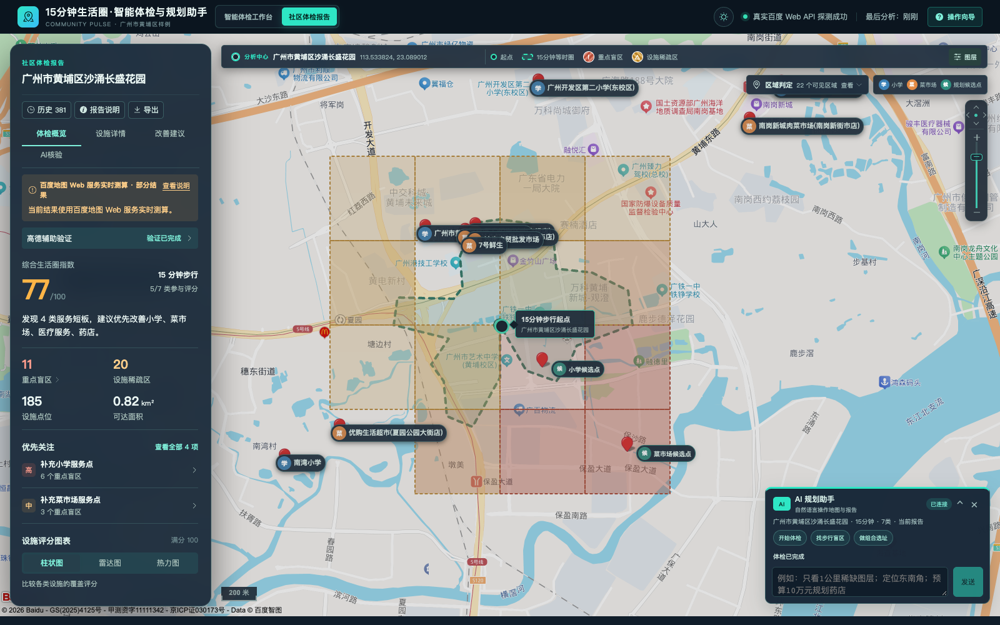
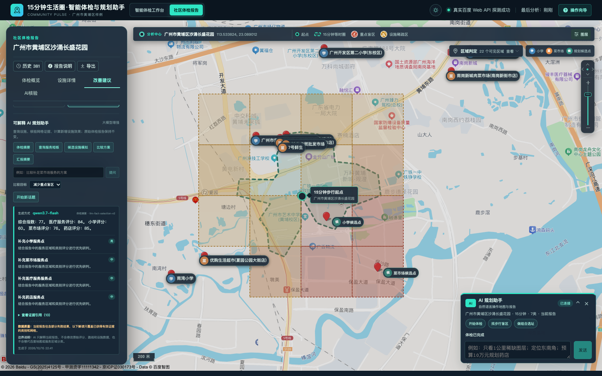
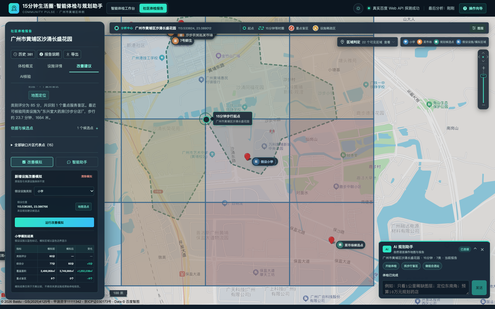

# 作品介绍文档

## 基于地图开放能力的
## “15分钟生活圈”智能体检与规划助手

让社区服务可达性可计算，让规划建议有证据可查。

2026 上海开源软件应用创新大赛｜开源 AI 工具赛道

参赛候选版本：2.3.0｜编制日期：2026年10月15日

:::cover

项目面向社区规划与公共服务评估，围绕“居民能否步行到达、服务缺口在哪里、补充设施能改善多少”三个问题，将百度地图真实步行路线、可解释空间计算与 AI 工具调用融为一体。用户可通过地图或自然语言发起体检，查看七类民生设施、等时圈、服务盲区与规划模拟，并导出带来源和质量说明的报告。

当前以广州市黄埔区沙涌长盛花园为主要样例；支持无密钥离线复现。源码采用 Apache-2.0 协议开放。

代码仓库：https://github.com/PengJunPJ/life-circle-assistant

<!-- page -->
# 01 项目背景与应用场景

## 从“画一个圆”走向“能否真正步行到达”

“15分钟便民生活圈”关注居民在日常步行范围内获得购物、医疗、教育、养老等基础服务的便利程度。现实中的河道、封闭小区、出入口和道路绕行，使直线距离无法等同于步行时间；只统计 POI 数量，也难以揭示社区内部的空间不均衡。人工普查和静态图表则面临更新成本高、分析口径不统一、建议缺少量化对比的问题。[R1]

本作品以百度地图路径规划的步行时间为主要可达性依据，对设施、网格、评分和规划假设建立共同的数据契约，帮助用户从发现问题走到方案比较。系统不声称能够实时感知所有围挡、信号灯和现场通行变化；这类信息可通过居民观察和人工核验补充。[R2][R5]

## 面向三类使用者的实际工作

| 使用者与场景 | 典型问题 | 作品提供的输出 |
| --- | --- | --- |
| 街道与社区管理人员：公共服务体检 | 哪些片区买菜、买药、就医或上学不便？ | 分类覆盖、最近步行时间、重点盲区和证据网格 |
| 规划师与公共服务研究人员：设施补短板 | 新增设施放在哪里？不同方案如何比较？ | 候选点、改善模拟、组合约束、前后指标及待核验条件 |
| 居民与教学参与者：理解与反馈 | 为什么附近有设施却仍然不便？报告依据是什么？ | 地图路线、证据解释、角色报告、文字或图片观察入口 |

## 项目定位与价值

作品是一款可部署、可复现的社区空间分析 Web 工具，当前处于功能型 Beta 阶段。它把地图 API 的测量能力、确定性算法的可解释性与自然语言交互结合起来，降低社区体检和初步规划研究的操作门槛。现有材料支撑样例演示与工程验证，尚未形成规模化实际用户或正式规划采纳的统计数据。

> 一份报告同时回答：结果是什么、依据在哪里、哪些信息仍然未知。

<!-- page -->
# 02 产品体验与核心功能

## 一条完整的“体检—解释—改善”路径

:::workflow

用户可搜索地址、地图选点或输入坐标，也可说“体检沙涌长盛花园，步行15分钟，关注买菜和买药”。系统整理参数、澄清歧义，经用户确认后启动任务；支持10、15、20分钟及快速、正式两档精度。[R2]



| 功能 | 用户可获得的结果 |
| --- | --- |
| 七类设施体检 | 菜市场、药店、小学、医疗服务、养老、公园绿地、便利超市的数量、可达性与分类评分 |
| 直观可视化 | 等时圈、分类网格、设施与路线图层，配合柱状图、雷达图及证据详情 |
| 改善与报告 | 新增设施模拟、多方案与历史报告比较；JSON、CSV、BD-09/WGS84 GeoJSON 和 PDF 导出 |

本文截图均采集自当前真实服务。本次便利超市检索达分页上限、公园检索遇日配额限制，报告保留“部分结果”，仅5类参与评分；离线复现另见第08章。

<!-- page -->
# 03 技术架构与数据流

## 地图测量、空间计算、AI 交互各负其责

:::architecture

| 层次 | 技术选型与职责 |
| --- | --- |
| 交互与可视化 | Vue 3、TypeScript、Vite、Element Plus、ECharts；地图工作台、对话、报告、图层与审核入口共享状态 |
| 接口与执行 | Python 3.12、FastAPI、Pydantic、HTTPX；参数校验、异步分析、工具白名单、预算、任务进度与中断恢复 |
| 领域计算与治理 | 等时圈、设施归一、网格分类、固定规则评分、模拟与组合求解；设施目录版本、居民观察及证据审核 |
| 存储与交付 | SQLite 保存报告、缓存、会话、审核和账本；ReportLab 导出 PDF；Docker Compose 与 Nginx 交付应用 |

## 一次体检如何成为可追溯报告

输入先统一为 BD-09 坐标，再进行设施检索、清洗、步行测量、区域分类和评分。报告保存参数、来源、规则版本、完整性和执行指标；前端地图、导出与 AI 解读读取同一份报告事实，避免不同出口产生不同结论。[R2][R3]

已完成报告保持不可变。审核设施或调整规划场景时，通过新目录版本或新场景计算产生新结果，原报告保留用于对照。执行账本记录实际 HTTP 尝试、物理路线对、模型用量及预算；无法核验的费用保留未知。[R5]

<!-- page -->
# 04 地图能力与核心算法

## 以路线服务构建近似等时圈

正式分析采用24方向、快速分析采用16方向的径向采样，先批量获取外围采样点步行时间，再沿各方向二分细化阈值边界，形成近似等时圈。该方法利用真实路线测时，无需下载底层路网；有限方向采样仍可能遗漏狭长通道或复杂障碍结构。采样失败和降级会写入报告。[R3]

百度原生步行等时圈已具备可选适配、权限探测和失败回退，默认关闭。是否具备账号权限、真实边界精度与实际计价，需在部署账号上另行验证，不能凭配置宣称已获授权。[R6]

## 四类核心设施的网格盲区判断

对中心周边约2×2公里范围建立4×4网格，分别评估菜市场、药店、小学、医疗服务，共64个“类别—网格”判断单元。养老、公园绿地和便利超市展示覆盖及最近可达，不冒称具有相同深度的网格测算。

| 判断条件 | 空间解释 |
| --- | --- |
| 最近同类设施步行超过阈值，且格中心1公里内无同类设施 | 重点服务盲区，优先关注供给缺失和可达性问题 |
| 仅满足上述一个条件 | 设施稀疏区，进一步区分稀缺与步行超时 |
| 条件均不满足且证据完整 | 正常覆盖区 |
| 检索或路线证据不足 | 计算不完整，不包装成“无设施”或正常覆盖 |

类别评分采用“数量40%＋最近步行40%＋空间分布20%”固定规则；综合分按有效类别权重归一化。该评分是项目解释性指标，不代表国家或地方的法定规划评价标准。[R3]

## 在配额约束下提高稳定性

逐词 POI 检索后按标识、名称和坐标去重，并做语义归一；直线距离仅用于候选预筛。步行矩阵按最多100点对分块，失败回退逐对路线；结合24小时缓存、QPS节流、有限重试和退避控制开销。主报告采用百度数据；多源对齐与高德辅助观察属于受控扩展，不宣称已实现双源验证效果。

<!-- page -->
# 05 创新点：能执行、可核验的 AI 助手

## 创新一：自然语言连接地图、报告与工具

用户可连续提出“只看药店盲区，定位东南角，再导出标准GeoJSON”等操作。共享状态串联地图、报告与工具；最多六步持久计划支持澄清、取消、继续和失败恢复，并受白名单、参数契约及预算约束。[R2][R5]



## 创新二：事实由后端控制，模型负责选择与组织

路线、评分、盲区和模拟由确定性计算产生。模型选择报告绑定的事实槽位与既有建议，服务器渲染数值及事实文本；模型失败时明确标注规则降级，体检仍可运行。[R5]

## 创新三：从“解释报告”扩展为“修正数据”

设施语义审核、居民观察、人工复核和版本化重算相连接。漏设施、关闭或围挡先记为待核验，接纳后更新目录或可信障碍，再生成新报告并保留原结论。嵌入与OCR效果需独立验收。[R5]

## 创新四：对不确定区域主动补测

在路线预算内，按风险、阈值邻近性及不确定性选择测点，以高斯过程形成预测图层。观测、预测和未决区分开展示；可信障碍参与分组，未知孔洞保持未知。预测不进入正式评分，现场误差与API节省尚待验证。[R6]

实际模型调用证明交互链路可运行，不等同于AI准确率、规划效果或配额节省的独立评估。

<!-- page -->
# 06 应用深化：从发现缺口到比较方案

## 新增设施改善模拟

用户可选择系统候选点或地图选点，假设新增一处设施，由后端重新计算受影响类别的覆盖、盲区和评分。界面展示原报告、假设场景与指标变化，支持选择不同方案对照。候选与模拟是辅助研判，不意味着地块已取得建设许可。[R2]



## 带约束的组合选址

进一步的组合规划支持预算、数量、必选或禁选候选、分类数量、最低容量及核验人口等约束。针对已登记候选执行小规模精确枚举，按组合整体复算，并呈现覆盖、成本、数量或人口收益的非支配方案，供规划人员选择。[R5]

系统只使用有来源和核验状态的成本、容量、用地及人口字段；缺项保持未知，不将其视为零或自动满足。最优性仅针对给定候选、有效测量与有限枚举模型。人口受益需按可达网格并集去重；分类覆盖面积之和也不等同于跨类别地理并集。

## 一份数据，面向不同角色

居民报告突出日常可达与反馈入口；社区报告突出短板和核验事项；规划师报告区分观察、假设、措施及适用条件，并引用项目规则或已配置规范。角色变化调整表达和关注点，保持基础事实一致。[R5]

<!-- page -->
# 07 样例验证与已有成果

## 真实社区与缓存性能实测

主要样例为广州市黄埔区沙涌长盛花园，中心BD-09坐标约为113.533824、23.089012。2026年10月12日，候选版2.3.0以15分钟、正式分析和七类设施完成冷、热缓存两次真实百度复测，两份报告均为完整结果。[R4]

| 同参数实测场景 | 报告记录耗时 | 地图API调用 | 步行缓存命中 |
| --- | --- | --- | --- |
| 冷缓存，关闭种子导入 | 149.156秒 | 263次 | 0 / 1291 |
| 热缓存，复用同参数结果 | 13.218秒 | 18次 | 1291 / 1291 |

配置为百度全局QPS 1.5、步行QPS 8、最大并发6。以上为两次历史测量，说明缓存复用价值，不代表当前所有功能或任意社区的延迟承诺；热缓存仍需进行POI等请求，不等于全部离线。[R4]

## 正确性、交互与工程验证

2026年10月4日，沙涌样例64个类别—网格单元完成同源复核：32个正常覆盖、21个稀疏、11个重点盲区，系统与人工复核一致。由于使用相同百度来源与分类规则，该结果仅证明本次口径一致，不能当作独立准确率或跨社区泛化成绩。[R7]

2026年10月14日的最终归档记录为后端511项、前端193项测试通过，且通过静态检查、类型检查、前端生产构建和隔离容器冒烟。实际HTTP与浏览器验收覆盖对话、审核、导出、计划恢复和报告不可变等流程，业务API未被拦截，外部收费服务调用为零。[R5]

## 当前成果的证据边界

软件链路、接口契约和可复现交付已有归档证据。真实嵌入/LLM/OCR效果、主动采样现场误差、原生等时圈账号权限、独立多源设施标签、地块可建设性和真实账单仍需专项验收。合成消融和离线回放不替代这些结果。[R5][R6]

本页性能与测试数据引用已有归档。2026年10月15日为更新产品截图，另行运行真实地图体检、模型解读与改善模拟；未重新执行上述完整业务回归，亦未将新截图作为独立模型效果评估。

<!-- page -->
# 08 开源交付与持续发展

## 让评审能够快速复现

源码仓库采用Apache-2.0许可证，根README提供统一入口。当前候选功能以仓库说明的候选分支及具体提交为准，正式标签发布仍需通过远端门禁。应用包含前后端源码、示例快照、自动化测试、Docker配置、技术设计、验证归档和治理文档。[R2][R8]

```sh
# 在完整源码仓库根目录启动评审演示
bash demo.sh
# 对运行中的演示进行链路复验
bash demo.sh test
```

演示入口默认http://localhost:5173，提供15分钟七类设施的合成样例、规则解读与导出验证。首次构建需联网获取镜像和依赖；预先制作匹配架构的离线镜像包后，可离线导入运行。离线流程不需要地图或模型密钥，也不证明外部模型效果。[R8]

## 开源工程与数据责任

GitHub Actions覆盖质量、安全与发布流程；贡献指南、安全策略、维护者职责、ADR和变更记录支持协作与追溯。依赖清单、第三方声明和SBOM资料便于持续核查。源码开源不等于地图POI、底图或模型服务数据可自由再分发，使用仍须遵守相应服务条款。[R9]

真实模式由用户自行配置百度服务端和浏览器凭证，密钥不写入报告。外部AI启用时，相关需求和工具上下文会发送到所配置服务。当前未实现登录鉴权、多租户隔离与生产备份，适合受控部署、研究和演示，不应将默认服务直接公开暴露。[R2]

## 后续发展路线

近期优先扩展不同路网社区的独立现场核验、建立障碍两侧与空间块留出数据，评估主动补测及语义审核的真实效果；取得合法授权并完成50—100对双源人工标签后，再报告多源精确率、召回率和F1。中期完善生产安全与运维、候选地块核验及数据更新机制，推动社区和规划人员参与持续共建。[R9]

<!-- page -->
# 09 赛题对应与材料索引

## 对应百度地图命题要求

| 专项维度及权重 | 作品响应与查阅位置 |
| --- | --- |
| 功能正确性与覆盖率 40% | 坐标转换、POI、步行路线、近似等时圈、菜市场/药店/小学等盲区；见第02、04、07章 |
| API深度调用与工程优化 30% | 步行矩阵分块、缓存、限流重试、失败披露、扇形采样与预算补测；见第04、05、07章 |
| 产品交互与用户体验 15% | 自定义中心点、地图网格、柱状/雷达图、对话操作、方案对比与导出；见第02、05、06章 |
| 开源工程规范 15% | Apache-2.0、统一README、Docker、自动化测试与CI、密钥配置和治理资料；见第03、08章 |

专项权重来自原命题PDF；不与赛事通用评分自行加权折算。文档同时呈现场景落地、技术创新、开源治理与长期维护计划，供综合评审参考。[R1][R10]

## 参考资料与可核验证据

以下路径相对于Git仓库根目录；编号对应正文引用。

- [R1] 百度地图命题说明PDF：《基于地图开放能力的“15分钟生活圈”智能体检与规划助手》，第1—2页。
- [R2] 根目录 README.md；life-circle-assistant/docs/应用技术说明.md。
- [R3] life-circle-assistant/docs/contest/algorithm-overview.md；docs/adr/0004、0006、0009、0010、0011系列决策。
- [R4] life-circle-assistant/docs/performance/v2.3.0-real-cold-warm-20261012.json；同目录v2-baseline.md。
- [R5] life-circle-assistant/docs/validation/ai-first-completion-2026-10-14.md；同目录ai-first-http-smoke-2026-10-14.md。
- [R6] life-circle-assistant/docs/validation/spatial-completion-2026-10-14.md；同目录ai-first-ablation-fixture-2026-10-14.md。
- [R7] life-circle-assistant/docs/validation/results/shachong-changsheng-20261004.md；同目录上级v2-real-community-comparison.md。
- [R8] life-circle-assistant/docs/contest/quick-start.md；life-circle-assistant/docs/releases/v2.3.0.md。
- [R9] CONTRIBUTING.md、SECURITY.md、MAINTAINERS.md；life-circle-assistant/docs/governance/下的开源治理、依赖合规与维护路线资料。
- [R10] life-circle-assistant/docs/research/contest-official-requirements-2026.md（2026年10月9日官方规则核验归档）。

代码仓库：https://github.com/PengJunPJ/life-circle-assistant

作品介绍范围：说明项目、实现与证据；不替代独立的技术设计文档、真实对比报告或演示视频。
