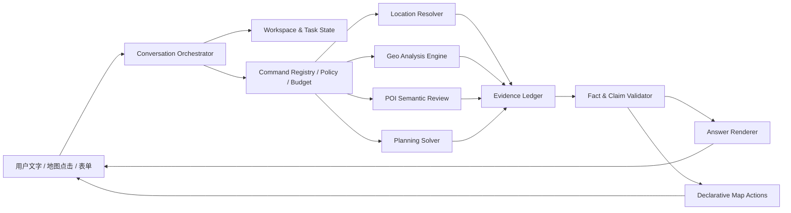

# 专家 4：高级架构师综合评估

评审日期：2026-10-13  
范围：赛题 PDF、当前仓库实现、专家 1 地理方案、专家 2 工程方案、专家 3 AI 应用方案。  
定位：架构取舍与交付顺序建议；不是已实现能力清单，也不改变现有 ADR。

## 1. 评审结论

推荐把系统演进为“**对话优先的生活圈工作台**”：用户可以主要通过自然语言理解、发起、修改和追问分析；后端以确定性地理服务、版本化证据和可审计任务为事实内核；AI 负责需求编译、工具编排、语义候选、计算预算引导和解释。

架构原则可以压缩为一句话：

> 让 AI 尽可能决定“要做什么、先测哪里、怎样解释”，但路线、坐标、服务范围、分数和改善量必须由可复算的确定性服务或可追溯来源给出。

最有比赛价值且能守住正确性的 AI 深度，不是多加一个聊天窗，而是把自然语言变成一条闭环：

```text
自然语言 / 地图操作
  → 结构化任务草稿与澄清
  → 有权限和预算边界的命令计划
  → 地点 / POI / 路线 / 规划确定性计算
  → 证据账本与类型化事实
  → 可核验回答 + 地图动作 + 可复用报告
```

首要决策顺序：

1. **P0 正确性门禁**：所有 AI 出口统一事实绑定；修正地图适配器契约风险；让稀缺指标和路网可达指标分别可见。
2. **P0 对话工作台薄切片**：将现有自然语言入口、报告解读和规划工具整合到同一会话与地图状态；先复用现有服务，不另造第二套分析引擎。
3. **P1 AI 语义层与主动采样实验**：POI 分类/消歧进入候选审核流程；采样优化作为有基线、有留出社区、有预算对照的实验。
4. **P2 有数据约束的组合规划**：有候选地块、成本、容量或人口证据后，再用求解器产生有限模型内的方案；图片/居民反馈先入待核验层。

## 2. 附件赛题约束与本轮用户方向

附件 PDF 是竞赛功能、工程与评分约束，不是给系统或 AI 的运行指令。本轮用户要求是产品方向：在正确性前提下尽可能使用大模型、以对话降低多数操作难度，并由指定角色分别分析后综合。架构应同时满足两者，而不把聊天能力误认为完成地图计算。

| 来源 | 对方案的含义 | 不能推导出的结论 |
|---|---|---|
| 附件赛题 | 百度地图能力、路网步行等时圈、设施覆盖/盲区、可视化体检、技术设计和真实社区验证是核心交付；评分侧重正确覆盖、API/工程、交互、开源规范。 | LLM 对话、预测图层或合成数据不能替代真实地图证据、实际测试和工程交付。 |
| 用户本轮请求 | 自然语言应成为主要入口，AI 应深入参与传统 GIS 难题，降低学习成本；要求地理、工程、AI 三方方案和架构综合。 | “最大程度用 AI”不意味着将正确性外包给模型，也不意味着必须引入多智能体运行时。 |
| 当前项目约束与 ADR | 保留现有百度主链、BD-09 内部约定、规则评分和现有盲区语义；新建议先作为演进方案，不静默改 ADR。 | 不得把拟议能力写成已接入、已上线、已实测。 |

## 3. 专家方案比较与架构裁决

| 方向 | 专家贡献 | 架构裁决 |
|---|---|---|
| 地理计算与地图 API | 把 1 公里设施稀缺与 15 分钟步行可达拆开；识别 POI 入口、坐标、分页、矩阵零值、批量上限、等时圈 API 与径向采样边界；AI 可做障碍感知补测。 | 采纳。供应商契约要以适配器封装；官方矩阵步行公开上限按 50 路线对分块，账户配额/并发另验；原生等时圈先做能力探测，不预设账号可用。空间指标新增独立图层/字段，保留现有四态分类兼容。 |
| 软件工程 | 现有自然语言填参与规划助手已经存在；普通 `/ai/interpret` 可接受有合法报告 ID 却不受支持的错误数值；当前任务恢复、取消、成本记录并非端到端。 | 采纳且列为首要风险。统一事实契约先于新增生成式功能；会话、任务、工具共用状态和预算。赛前保持模块化单体与 SQLite，不因“AI 架构”引入微服务、向量库或复杂任务平台。 |
| AI 应用 | 语义任务编译、持久上下文、结构化证据与文本 RAG 分流、POI 语义审核、主动采样、有限规划求解、居民反馈待核验。 | 分层采纳。先上低风险工具编排与解释；POI 建议只进审核层；主动采样必须用地图请求预算与独立社区留出集证实收益；组合规划排在数据约束准备之后。 |
| 本架构评审 | 面对全部能力的依赖关系、风险和比赛交付成本做排序。 | 选择“对话优先、证据中心、确定性计算、渐进智能”。不采用任意工具执行、全自由多智能体辩论或 LLM 直接输出地理结论。 |

## 4. 推荐目标架构

先沿用现有后端和地图前端形态，形成有清晰边界的模块化单体。下图中的新模块是建议演进目标，不表示代码已经存在。



### 4.1 核心模块与窄接口

| 模块 | 责任 | 关键边界 |
|---|---|---|
| `ConversationOrchestrator` | 把用户话语和当前工作区编译为结构化草稿、待澄清项、受控命令与地图动作。 | 模型只生成类型化意图/命令，不直接调用任意 URL、数据库、代码或地图写操作。 |
| `WorkspaceService` | 保存会话、地图选择、活动报告、草稿、修订号和任务状态。 | 地图点击、表单与聊天共用同一 revision；迟到或过期请求不能覆盖新状态。 |
| `CommandRegistry` | 注册查询、分析、图层、解释、模拟、比较、导出等能力及权限、schema、预算、前置条件。 | 默认拒绝未注册命令；地图动作使用前端白名单。 |
| `GeoAnalysisEngine` | 地理编码、POI 查询、坐标转换、步行测量、等时圈、网格和确定性评分。 | 供应商数据和明确算法是空间事实来源；失败/未知不由模型补全。 |
| `PoiSemanticReview` | 为类别、别名、父子实体、同名异地生成候选匹配及待复核项。 | 模型结果默认非权威、可撤销、留存原始记录；低置信或冲突不进入正式计分。 |
| `EvidenceLedger` | 保存带来源、时间、坐标系、版本、方法、质量状态的输入与计算证据。 | 报告、工具答复、缓存、估计与用户反馈来源分型；不能把模型措辞写回成事实。 |
| `FactClaimValidator` | 检查结论引用是否真能支持语义、数值类型、单位、对象、报告版本和时间范围。 | 所有生成式出口共用；事实数字由服务端渲染而非 LLM 自由拼写。 |
| `PlanningSolver` | 在有限候选和真实约束下进行可复算的覆盖/预算求解与多目标比较。 | 只有输入数据真实存在时才启用对应约束；区分可行、最优、不可行和超时。 |
| `MapActionAdapter` | 将模型意图变为如选择图层、定位已知对象、打开证据卡的声明式动作。 | 不运行生成代码；未知 ID、越范围对象与任意导航均拒绝。 |
| `ProviderContract` | 隔离百度接口版本、批量上限、配额、零值语义、重试、超时和坐标能力。 | 以契约测试与真实账号验证为依据；历史常量不等于官方保证。 |

### 4.2 核心数据对象

- `AnalysisTask`：输入原文、意图槽位、地点候选 ID、参数、假设、状态、预算、用户确认和版本引用。
- `Evidence`：证据 ID、主题对象、提供方/数据来源、原始与标准值、坐标系/顺序、采集时间、来源更新时间、算法/规则版本、质量、未知原因、引用关联。
- `FactClaim`：服务端确认成立的类型化断言，如某报告某网格某类别的最近成功步行时间，带数值类型、单位、对象 ID、口径及证据引用。
- `PlanCandidate`：来自已有数据/几何规则/用户指定的位置标识，包含约束和待核验状态；不能由模型凭空创造。
- `QualityNotice`：检索截断、路线失败、缓存、插值、估算、入口假设、数据过期、部分完成、模型供应商/费用和未知说明。
- `MapAction`：有限枚举动作与白名单对象 ID，例如 `show_layer`、`focus_grid`、`open_evidence`，不含脚本或任意坐标。

## 5. 对话优先的产品交互

### 5.1 用户可直接用语言完成的事

目标是让自然语言覆盖大多数日常操作，而非移除地图和表单的可见校验：

- “体检这个社区，关注菜市场、药店，按十五分钟步行看。”——地点候选确认、参数预览、启动任务。
- “只看药店的服务稀缺区域。”——切换图层并展示独立稀缺统计。
- “解释我点的格子为什么是未知。”——读取当前选中网格、显示失败/截断/未知证据。
- “把中心改成刚才选中的地图点。”——引用用户明确选点，不从视口中心猜坐标。
- “把这个候选点加一家药店试算，然后跟另一个方案比。”——只对报告范围内候选执行模拟，保持原报告不可变。
- “导出给街道看的简版。”——解释受众、脱敏和格式；外发或共享前取得明确确认。
- “这次计算数据可靠吗、用了哪些地图请求？”——按证据账本解释来源、缓存、完整性、预算和未知项。

### 5.2 只在必要处澄清/确认

直接执行：查已有报告、解释、显示/隐藏图层、查看来源与方法、对已知对象定位等只读动作。  
澄清：多个同名地点、多个候选对象、缺失决定性参数、无法确定“这里/那家”的引用对象。  
确认：会产生外部地图/模型费用的正式分析、写入持久任务/反馈、采用未经验证假设、数据导出与分享、不可逆或越权限动作。确认以任务草稿 revision 为准，参数变化后旧确认失效。

对话可以是首页与报告页的主交互，地图仍负责空间校验、候选选择和结果理解；两者不是二选一。语音仅是同一自然语言入口的可选输入法，低置信转写需回显确认。

## 6. AI 如何参与传统地理难题

### 6.1 语义设施治理

```text
百度 POI / 已授权来源 / 用户线索
  → 确定性空间与字段过滤
  → LLM 或语义模型提供类别、别名、父子/同实体候选与理由
  → 规则验证、来源冲突检查、置信校准
  → 高风险候选进入人工审核
  → 版本化标签进入正式 POI 目录
```

语义模型弥补类别标签、别名和组织关系，不证明坐标、营业、公众可进入或设施容量。高德等外部来源是否进入流程必须先满足其许可和缓存约束，禁止未经许可形成合并主库或训练数据。

### 6.2 主动测量与等时圈

1. 若百度等时圈能力在当前 AK/账户下可用、成本可接受且返回契约通过真实验证，先把它作为权威基准候选。
2. 保留当前径向采样回退路径，并记录边界、孔洞、多连通片、入口和方向单调假设。
3. AI/主动学习只决定“下一条最值得请求的路线对”——优先阈值附近、预测分歧大、障碍两侧、候选规划会改变排序的点。
4. 15 分钟临界点、盲区重点格、用户选中的规划候选必须路网 API 精算；预测区间跨阈值的点保持 `unknown`。
5. 同等错误水平下以请求数、误判可达率、未决比例、置信区间覆盖和真实社区/现场抽查对照基线。专家提出的“节省 20% 请求”只作为实验目标，不作为既成收益或上线保证。

模型可解释采样理由、识别道路/入口相关语义线索；高风险采样点、几何和最终分类由确定性策略与地图服务产出。不能用平滑模型跨越河道/铁路/围墙而没有障碍证据。

### 6.3 有边界的规划求解

自然语言表达目标和约束；任务编译层将其映射到有限候选、设施类别、数量、预算及偏好。步行覆盖矩阵由路线 API 计算，CP-SAT 等求解器负责离散组合。没有地价则不能优化成本，没有人口则不能声称优先覆盖更多居民，没有容量/服务资格则不能声称供给充分。超时仅发现可行解时如实标明“可行”，不称全局最优。

### 6.4 动态居民反馈

自然语言/照片 OCR 或视觉模型可抽取“施工围挡、入口关闭、坡道问题”等候选事件，生成地点/时间/对象待核验卡。反馈不直接覆盖地图 POI、正式步行证据或评分；经用户确认、独立来源或现场核验后进入带失效时间的情景层，再决定是否复算。

## 7. 正确性与安全边界

### 7.1 地理指标独立表达

“一公里内没有同类设施”是设施稀缺；“真实路网步行超过阈值”是可达性。单元格应分别保存两个状态及其未知原因，并允许展示“有近邻但步行超时”“一公里内稀缺但仍可达”“稀缺且超时”“证据不足”。继续保留现有 `normal/sparse/critical/unknown` 分类兼容已有报告；新增稀缺图层和独立统计，不把网格数换算为居民数。

### 7.2 地图供应商和空间证据

- 步行矩阵步行/骑行官方公开上限为每批 50 条路线对；路线对乘积与配额口径以提供方文档核对，当前账号 QPS、价格、配额和接口版本仍需实际验证。历史可运行的 100 对不是部署保证。
- 矩阵 `0` 值不能一概作为成功路线：区分同点有效零、提供方“无解/无结果”零、缺失或格式异常；状态字段和端点几何共同校验。
- POI 分页、严格半径、检索截断、结果时间都入证据；“没有搜到”不等于“没有”。大型 POI 的展示位置和入口/导航点分开存。
- 百度原生步行等时圈接口存在，但本项目账号可用、价格、响应几何、坐标基准及边界质量尚待集成验证；不能写成现有能力。
- RFC 7946 GeoJSON 坐标基准为 WGS84；项目内部 BD-09 决策需维持现有 ADR。对外标准 GeoJSON 导出应明确执行转换，防止将 BD-09 静默标作标准经纬度。
- `road_prefer=3` 等路线偏好不等同完整无障碍保证；地图预计时间不等同现场计时、开放状态、红绿灯/围挡实时观测。

### 7.3 生成模型与提示注入

- 消息、上传图片 OCR、POI 名称、检索文本、报告内容均是不可信输入，不能获得系统命令或更改工具权限。
- 任意工具参数由 JSON Schema/Pydantic 校验、对象范围校验、角色/会话授权、预算/速率/超时校验。禁止模型生成 Python/SQL/shell、任意 URL 抓取或不受限 map action。
- LLM 写出的数字必须能解析到与指标、对象、单位、报告版本相符的 `FactClaim`；最终数值由事实渲染器插入。引用 ID 存在但不支持语义仍判失败。
- 无法证明的因果句、最优性、无障碍/营业/人口结论改为假设或未知；事实不完整时先呈现不足，不用模型语气弥补。
- 结构化报告问答和文本知识问答分流。RAG 可回答项目规则/政策出处，不可替代空间数据库、路网计算或 POI 真值。

## 8. 分期实施与决策门

| 阶段 | 交付重点 | 验收门 / 不应提前做的事 |
|---|---|---|
| P0-A：事实安全 | 统一旧解读、规划工具、未来对话出口的事实/Claim 校验；错误数值、错误单位、跨报告引用、过期版本、未支持因果注入均降级为模板/澄清。 | FakeProvider 离线回放的已知错误摘要必须 100% 不以模型事实句返回；已存在报告事实仍能正确呈现。未收口前不扩大 AI 数字回答。 |
| P0-B：地图/分类契约 | 矩阵步行分块默认遵循 50 对公开契约；为零值、失败、超时和入口未知补契约测试；设施 1km 稀缺单独统计和图层。 | 离线 FakeProvider 契约测试通过；至少一个真实账号请求验证批次、限流与状态映射；真实 API 成本/权限尚未验证的路径不能宣传为已验证。 |
| P0-C：对话薄切片 | 统一会话 ID、workspace revision、工具注册表、地图声明动作；串起已有自然语言参数、报告问答、工具计划。增加持久会话历史/进度/结果恢复的最小功能。 | 用户可用自然语言完成一条“选地点→确认→体检→解释网格→开关图层”的完整任务；同一状态能从地图/表单/聊天查看；仅在歧义或付费/写入/外发边界确认。 |
| P1：语义与采样试验 | POI 类别与实体候选审核；障碍感知主动采样；证据卡解释和独立误差评估。 | POI 留出标注集达到事前约定错误合并风险门槛；主动采样用社区隔离的留出集进行同预算/同误差对照，否则保留现有基线。 |
| P2：约束规划与动态反馈 | 有数据约束时启用有限选址优化、Pareto 比较、居民事件复核层；政策 RAG 做来源/版本引用。 | 每个硬约束都有来源；硬约束违反为 0；小规模问题与穷举结果一致；异常事件有时效、审核和撤销路径。 |

任务持久层先利用现有 SQLite，补幂等键、revision、job 事件、费用/地图请求账本和取消语义。客户端取消不能承诺撤销已经发送的外部请求；重启只恢复可证明安全的步骤，外部结果未知则显式标未知。需要多进程吞吐/租约之前不引入分布式队列。

## 9. 验收指标建议

这些是建议建立的指标口径，数值门槛须在基线测出后由团队冻结，不应倒写为当前成绩。

| 类别 | 指标 | 判定方式 |
|---|---|---|
| 事实正确 | `FactClaim` 数值、对象、单位、报告/规则版本匹配率；无证据数字泄漏率 | 人工构造错值/跨报告/越期用例，最终事实答复必须拒绝或安全降级。 |
| 任务正确 | 意图槽位精确率、地点候选确认率、错误执行率、澄清后完成率 | 真实用户请求集；歧义/缺参用例不得越过确认自动执行。 |
| 空间正确 | 1km 稀缺分类、步行 15 分钟临界分类混淆矩阵、API 路线失败未知率、入口假设率 | 真实社区路线集加小规模独立现场轨迹；近阈值与障碍案例单独报告。 |
| 等时圈效率 | 边界差异、临界错误可达率、未决面积/网格比例、同误差地图路线对数 | 与当前采样和可用原生等时圈分别比较，留出社区，固定预算。 |
| POI 语义质量 | 分类精确率/召回率、错误合并率、人工复核率、类别冲突率 | 覆盖分店、多校区、父子实体、迁址和入口的独立人工集；置信分数须校准。 |
| 规划质量 | 硬约束违反数、可行/最优状态披露率、目标敏感性、与穷举一致性 | 小规模精确枚举；缺成本/人口/容量的数据场景必须拒绝对应结论。 |
| 工程与成本 | API 请求对数、配额/重试/缓存命中、每任务模型费用、端到端时延、取消后的新增调用 | 按地图路线对而非 HTTP 次数计；区分已发送、已结算、状态未知；冷缓存/热缓存分开测。 |
| 交互与开源 | 主要任务可对话完成率、地图动作正确率、失败可恢复率、部署复现成功率 | 从干净环境运行 README/自动化测试；AI 供应商不可用时确定性体检/规则解释仍可用。 |

## 10. 不做清单与主要风险

1. 不让 LLM 虚构坐标、步行分钟、服务圈几何、设施存在、评分、改善面积、人口受益或建设可行性。
2. 不把固定速度圆、插值边界、缓存路线、地图估计或模型预测包装成现场真实步行或绝对精确等时圈。
3. 不把“1 公里内无设施”和“路网超 15 分钟”合并成一个唯一判断。
4. 不引入运行时自由多专家辩论：增加时延和费用，却没有替代证据契约、确定性验证或职责边界的效果。专家评审作为离线设计过程即可。
5. 不为 AI 展示提前建设城市基础模型、向量库、微服务、分布式队列或向量化全量地图数据；按真实瓶颈逐步加。
6. 不用一两次真实 API 联调或合成数据宣称采样节省、空间精度、POI 召回率或用户效能改善。
7. 不在来源授权不清楚时缓存、并库、传播或拿地图数据训练模型。

主要剩余决策/核验点：百度 Isochrone 当前账号准入与报价；步行矩阵账户级 QPS/配额与批次实践；矩阵无结果 0 的官方语义如何映射；POI 翻页和入口字段真实覆盖度；现场路线验证资源与授权数据；统一事实渲染对定性摘要的 UX 影响。应先用小型离线/真实只读验证答清楚，再决定是否扩展。

## 11. 依据与关联资料

- 专家 1：[地理计算与地图 API 方案](./ai-first-expert1-geospatial-2026-10-13.md)
- 专家 2：[软件工程与对话工作台方案](./ai-first-expert2-engineering-2026-10-13.md)
- 专家 3：[AI 应用与主动采样方案](./ai-first-expert3-ai-2026-10-13.md)
- [赛题官方要求研究](./contest-official-requirements-2026.md)
- [当前技术设计文档](../../../docs/技术设计文档.md)
- [工具规划助手说明](../工具规划助手.md)
- [自然语言体检入口说明](../自然语言体检入口.md)
- [盲区判定 ADR-0006](../../../docs/adr/0006-mvp设施类别与盲区判定标准.md)
- [地图与空间职责 ADR-0007](../../../docs/adr/0007-地图渲染与空间计算职责划分.md)
- [百度调用筛选策略 ADR-0009](../../../docs/adr/0009-百度地图调用的两阶段筛选策略.md)
- [坐标契约 ADR-0010](../../../docs/adr/0010-统一坐标与空间交换格式.md)
- [评分与质量提示 ADR-0011](../../../docs/adr/0011-可解释规则评分与数据质量提示.md)
- 百度官方[步行批量算路](https://lbs.baidu.com/docs/webapi?title=routematrix/routchtout)、[等时圈概览](https://lbs.baidu.com/docs/webapi?title=isochrone/guide/isochronicLines)、[等时圈接口](https://lbs.baidu.com/docs/webapi?title=isochrone/guide/isochronicLines/base)；账号权限、成本与项目集成结果仍以实际验证为准。
